# Informe de pruebas — ComedorUAGRM

Sistema de postulación y preselección de la Beca Comedor (DUBSS, UAGRM): backend (Spring Boot), panel web (React) y app móvil (Flutter). Este informe nombra primero las herramientas usadas y por qué, y después presenta la evidencia de las corridas hechas el 18/11/2026 en la rama `Mauro`.

---

## 1. Herramientas y justificación

| Herramienta | Qué prueba | Por qué se eligió |
| --- | --- | --- |
| **JUnit 5 + Spring Test + Testcontainers** | Backend: servicios, controladores y consultas contra un PostgreSQL real | Es el estándar de Spring Boot; Testcontainers prueba contra el mismo motor que producción (restricciones, Flyway) en vez de un mock. |
| **JaCoCo** | Cobertura del backend (líneas, ramas, métodos) | Se integra al `mvn test` sin cambiar los tests y genera HTML y XML. |
| **Vitest + Testing Library + `@vitest/coverage-v8`** | Panel web: schemas, componentes, pantallas, hooks | Corre sobre Vite sin configuración extra; el proveedor V8 da cobertura real sin instrumentar el código. |
| **`flutter test --coverage`** | App móvil: lógica, providers, pantallas (widget tests) | Es la herramienta oficial de Flutter; produce `lcov.info`, formato que entienden otros servicios. |
| **Bruno** | API REST: contrato (códigos HTTP, sobre `ApiResponse`, códigos de error, permisos por rol) | Las colecciones son archivos de texto versionados en el repo (a diferencia de Postman, que guarda en la nube) y el CLI (`bru run`) corre en CI sin cuenta. |
| **Playwright** | Panel web de punta a punta en un navegador real, con capturas | Ejercita el flujo completo (pantalla → API → base de datos) y deja capturas como evidencia. |
| **k6** | Rendimiento del backend bajo carga (usuarios virtuales, p95 de latencia) | Script en JavaScript, umbrales que hacen fallar la corrida y fácil de ejecutar en CI. Es manual, no corre en cada push. |
| **GitHub Actions** | Ejecución automática y archivo de reportes | Corre todo en cada push a `main` y a `Mauro` y guarda los reportes como artefactos descargables. |

Ya existían antes de este trabajo: Checkstyle, ESLint, `flutter analyze`, Ruff y pytest (módulo de IA).

---

## 2. Resumen de resultados

| Capa | Pruebas | Resultado | Cobertura |
| --- | --- | --- | --- |
| Backend core (JUnit) | 2032 (1 omitida) | **todas pasan** con Redis y Docker encendidos (ver 3.1) | **97,0 % líneas**, 84,6 % ramas, 97,3 % métodos |
| Panel web (Vitest) | 1296 en 147 archivos | **todas pasan** | **83,4 % líneas**, 82,2 % sentencias, 74,3 % ramas, 78,8 % funciones |
| App móvil (Flutter) | 310 | **todas pasan** | **78,7 % líneas** (2841 de 3610) |
| API (Bruno) | 191 peticiones, 444 aserciones, los 26 CU y las notificaciones push | **todas pasan** en local; se corre en local, no en el CI | — |
| E2E (Playwright) | 5 pruebas (4 flujos) | **todas pasan** | — |
| Rendimiento (k6) | 1 script | **no ejecutado localmente** (ver 4.3) | — |

---

## 3. Evidencia de cobertura

### 3.1 Backend (JUnit + JaCoCo)

Comando: `./mvnw test` (JDK 21, PostgreSQL local; el reporte sale en `target/site/jacoco/`). Datos: [`evidencia/jacoco.csv`](evidencia/jacoco.csv).

| Métrica | Cubierto | Total | % |
| --- | --- | --- | --- |
| Instrucciones | 43 979 | 45 252 | 97,2 |
| Ramas | 2 000 | 2 364 | 84,6 |
| Líneas | 6 670 | 6 877 | 97,0 |
| Métodos | 1 743 | 1 792 | 97,3 |

Cobertura de líneas por módulo: actas, asistencias, contacto, finalistas, mibeca, planillas y resultados 100 %; auth, becas, bitácora, comunicados, config, cotejos, dashboard, expedientes, notificaciones y security entre 98 y 99 %; convocatorias, postulaciones, preselección y usuarios 95 %; common 93 %; panel 88 %.

**Qué pasó con las dos fallas del primer intento:**
- `SecurityConfigTest.get_conOrigenPermitido_...` fallaba (503 en `/health`) porque no había Redis; con Redis encendido pasa.
- `PlanillaIntegrationTest.generar_conBecasVigentes_...` era un **error real de la prueba, no del entorno** (al principio lo atribuí a la codificación de Windows y me equivoqué): el PDF dice «Generado el» y la prueba esperaba «Generada el». Corregí la prueba (`PlanillaIntegrationTest.java`) y esa clase pasa completa (15 de 15).

Corrida completa con Redis y Docker (Testcontainers activo): 2032 pruebas, 1 omitida, y la única falla era la de la planilla, ya corregida. Los porcentajes de cobertura de arriba son de la primera corrida completa; no repetí la corrida completa después de corregir esa prueba, así que la cifra final podría variar mínimamente.

### 3.2 Panel web (Vitest)

Comando: `pnpm exec vitest run --coverage`. Salida: [`evidencia/vitest-salida.txt`](evidencia/vitest-salida.txt).

```
Test Files  147 passed (147)
     Tests  1296 passed (1296)
Statements   : 82.22% ( 4182/5086 )
Branches     : 74.3%  ( 3037/4087 )
Functions    : 78.77% ( 1592/2021 )
Lines        : 83.39% ( 3942/4727 )
```

La cobertura excluye `src/components/ui/` (salida del CLI de shadcn), las pruebas y `routeTree.gen.ts` (generado). Nota: en una corrida anterior, hecha mientras corrían a la vez las pruebas del backend y del móvil, dos pruebas de `RegistroScreen` fallaron por tiempo de espera; solas, pasan todas.

### 3.3 App móvil (Flutter)

Comando: `flutter test --coverage` → `All tests passed!` (310 pruebas). Cobertura de líneas desde `coverage/lcov.info`: **2841 de 3610 = 78,7 %**.

---

## 4. Evidencia de pruebas de sistema

### 4.1 API con Bruno

Colección en `tests/api-bruno/`, **una carpeta por caso de uso**: CU01 a CU26, el CU extra de notificaciones push (`CU27-EXTRA-01`) y una carpeta `CU00-Preparacion` que inicia sesión con cada rol (administrador, directivo, personal del comedor, becado y un postulante recién registrado) y ubica las convocatorias de prueba. En total son 191 peticiones; cada CU prueba su camino feliz, sus errores de negocio con el código `ERR_*` esperado y el permiso por rol (403 cuando corresponde). Comando: `bru run --env local`, con el backend en perfil `dev` sobre una base recién creada, y MinIO y Redis encendidos. Reporte HTML: [`evidencia/bruno-reporte.html`](evidencia/bruno-reporte.html).

```
Status        PASS
Requests      191 (191 Passed)
Tests         21/21
Assertions    444/444
```

| CU | Carpeta de la colección | Peticiones |
| --- | --- | --- |
| CU01 Registrarse y autenticarse | `CU01-Registrarse-y-autenticarse` | 11 |
| CU02 Enviar postulación | `CU02-Enviar-postulacion` | 6 |
| CU03 Precalificar con IA | `CU03-Precalificar-con-IA` | 4 |
| CU04 Consultar estado de postulación | `CU04-Consultar-estado-de-postulacion` | 3 |
| CU05 Auditar y adjudicar becas | `CU05-Auditar-y-adjudicar-becas` | 10 |
| CU06 Lista priorizada | `CU06-Visualizar-lista-priorizada` | 7 |
| CU07 Auditar expediente finalista | `CU07-Auditar-expediente-finalista` | 7 |
| CU08 Acta de adjudicación | `CU08-Generar-acta-de-adjudicacion` | 8 (3 usan MinIO) |
| CU09 Planilla de asistencia | `CU09-Generar-planilla-de-asistencia` | 7 (2 usan MinIO) |
| CU10 Asistencia digital | `CU10-Registrar-asistencia-digital` | 7 |
| CU11 Cotejo contra respaldo físico | `CU11-Cotejar-registro-contra-respaldo-fisico` | 5 (todas usan MinIO) |
| CU12 Dashboard BI | `CU12-Dashboard-de-indicadores-BI` | 8 |
| CU13 Convocatoria y gestión académica | `CU13-Gestionar-convocatoria-y-gestion-academica` | 16 |
| CU14 Usuarios y roles | `CU14-Gestionar-usuarios-y-roles` | 8 |
| CU15 Contraseña y perfil | `CU15-Recuperar-contrasena-y-gestionar-perfil` | 8 |
| CU16 Documentos adjuntos | `CU16-Digitalizar-y-adjuntar-documentos` | 2 |
| CU17 Borrador de postulación | `CU17-Guardar-borrador-de-postulacion` | 5 |
| CU18 Elegibilidad y duplicados | `CU18-Validar-elegibilidad-y-duplicados` | 3 |
| CU19 Devolver postulación | `CU19-Devolver-postulacion-para-correccion` | 4 |
| CU20 Archivar o rechazar | `CU20-Archivar-o-rechazar-postulacion` | 4 |
| CU21 Notificar y comunicados | `CU21-Notificar-finalistas-y-publicar-comunicados` | 6 |
| CU22 Publicar resultados | `CU22-Publicar-resultados-de-adjudicacion` | 8 |
| CU23 Padrón de becados | `CU23-Gestionar-padron-de-becados` | 12 |
| CU24 Historial y estado de beca | `CU24-Consultar-historial-de-asistencia-y-estado-de-beca` | 5 |
| CU25 Bitácora | `CU25-Consultar-bitacora-de-acciones` | 5 |
| CU26 Modelo y reprocesamiento | `CU26-Parametrizar-modelo-y-reprocesar-puntajes` | 6 |
| CU extra: notificaciones push | `CU27-EXTRA-01-Notificaciones-push` | 9 |

**Limitaciones (importantes):**
- 10 peticiones (generar y descargar acta y planilla, y todo el CU11) necesitan MinIO. Pasaron en mi máquina con MinIO encendido. Se corren en local con `docker compose up` (que ya incluye MinIO) y `bru run --env local`; `--exclude-tags minio` las omite si no hay MinIO.
- Se probó con las llamadas a la API; la subida real de archivos de CU16 (multipart) y el flujo de recuperación por el enlace del correo (CU15) no se cubren, solo sus errores y los listados.
- CU03 y CU26 prueban lo que hay con los datos de prueba (el módulo de IA real no corre en estas pruebas): la precalificación, el límite de 70 puntos y el rechazo de un modelo incompleto; no se prueba una versión válida del modelo.
- La colección está pensada para una base recién creada: algunas peticiones cambian el estado de las convocatorias de prueba (adjudican, publican, dan de baja), así que repetirla sobre la misma base falla en esos pasos.

### 4.2 Flujos E2E con Playwright

Código en `tests/e2e/specs/`. Comando: `npx playwright test`, con backend en perfil `dev` (datos de prueba) y el panel web levantado. Resultado: **5 pruebas, 5 aprobadas** (19,5 s) sobre una base recién creada. La prueba de adjudicación decide de forma definitiva sobre un finalista, así que en una corrida local repetida hay que recrear la base.

**Flujo 1 — Inicio de sesión (CU-01).** Credenciales incorrectas no dejan entrar; el administrador entra a su panel.

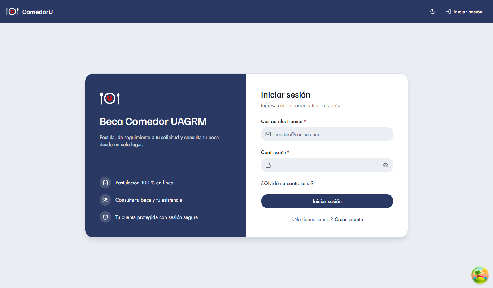
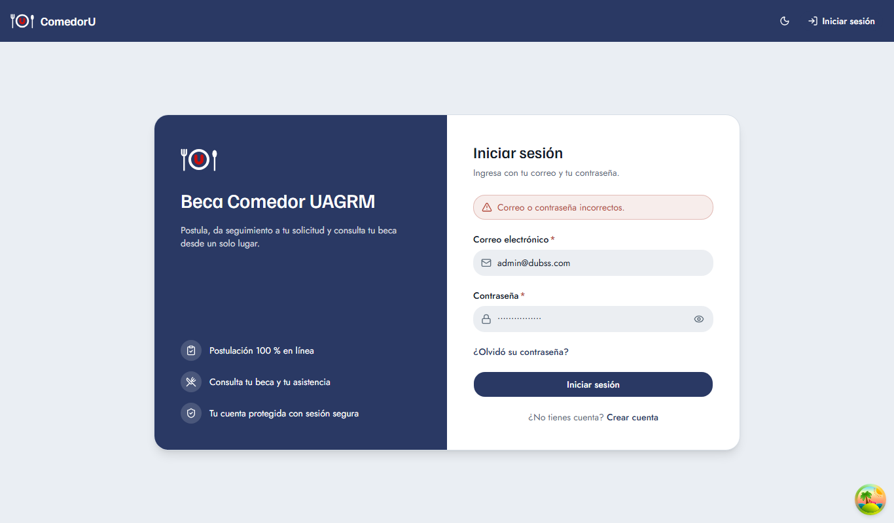
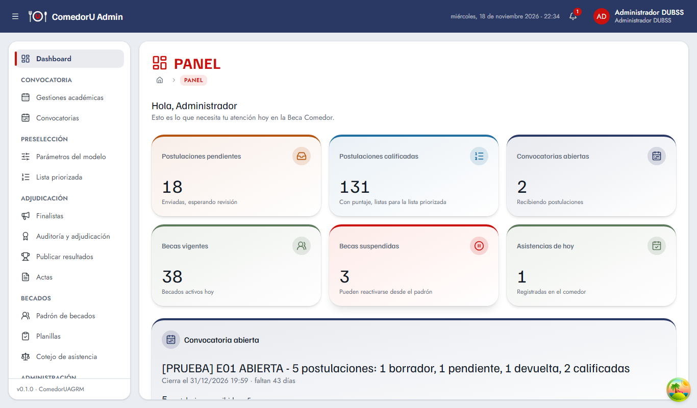

**Flujo 2 — Registro y postulación (CU-01, CU-16, CU-17).** Un estudiante se registra, entra a su panel, inicia una postulación, completa los datos socioeconómicos y guarda el borrador (se verifica el aviso «Borrador guardado»).

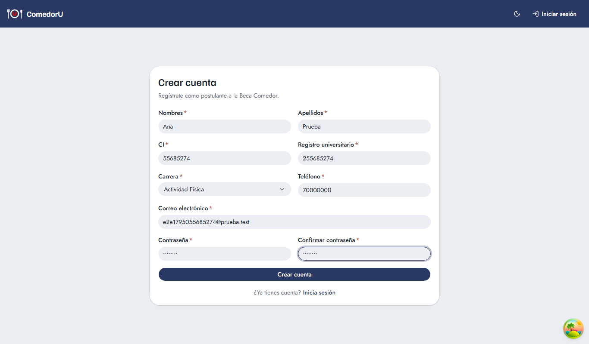
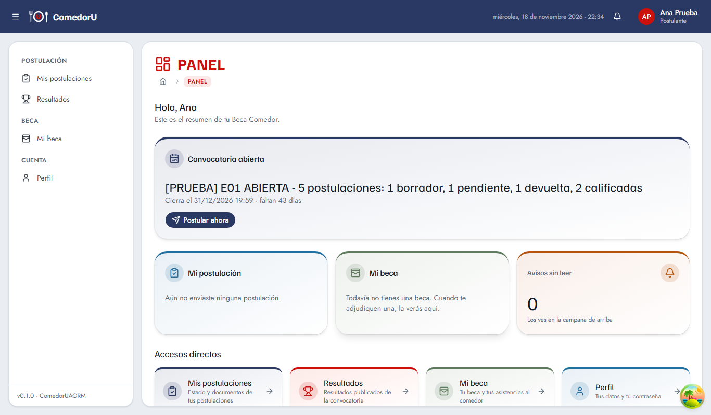
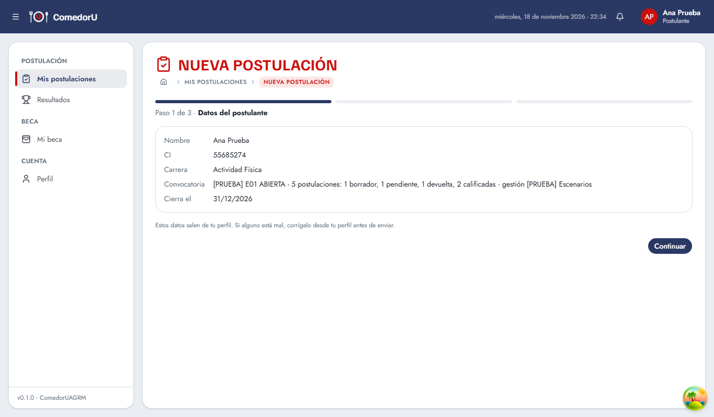
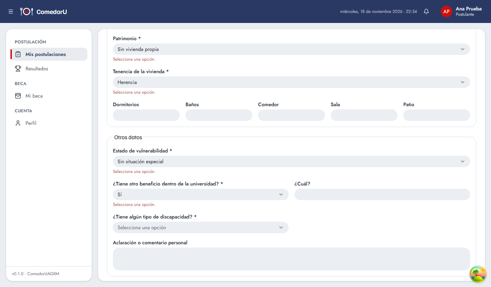
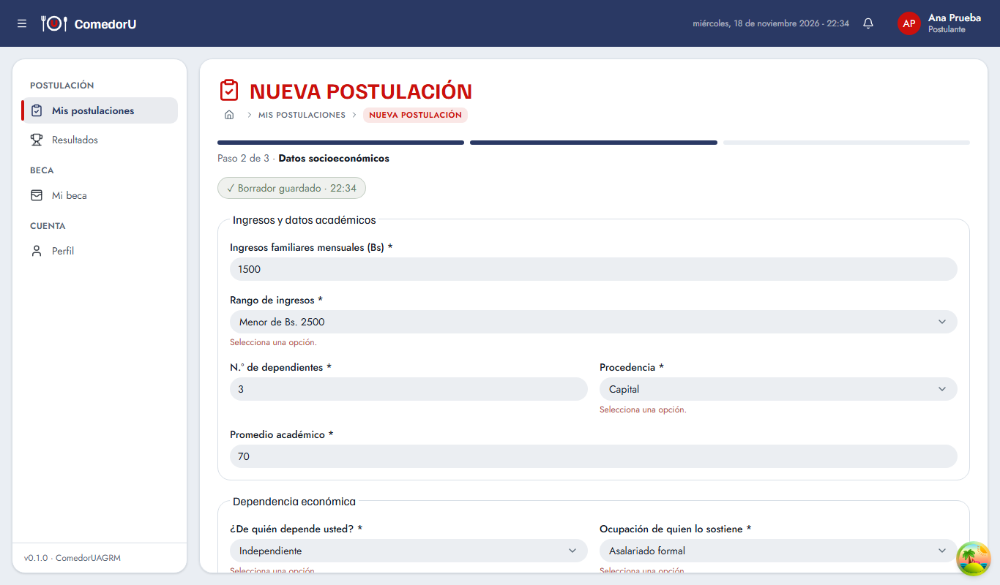

**Flujo 3 — Auditoría y adjudicación (CU-05 a CU-07).** El administrador elige la convocatoria de prueba E04, abre el expediente de un finalista ya validado, adjudica la beca tras confirmar que la decisión es definitiva, y el resumen de adjudicación pasa a mostrar 1 adjudicado y 2 cupos disponibles (de 3).

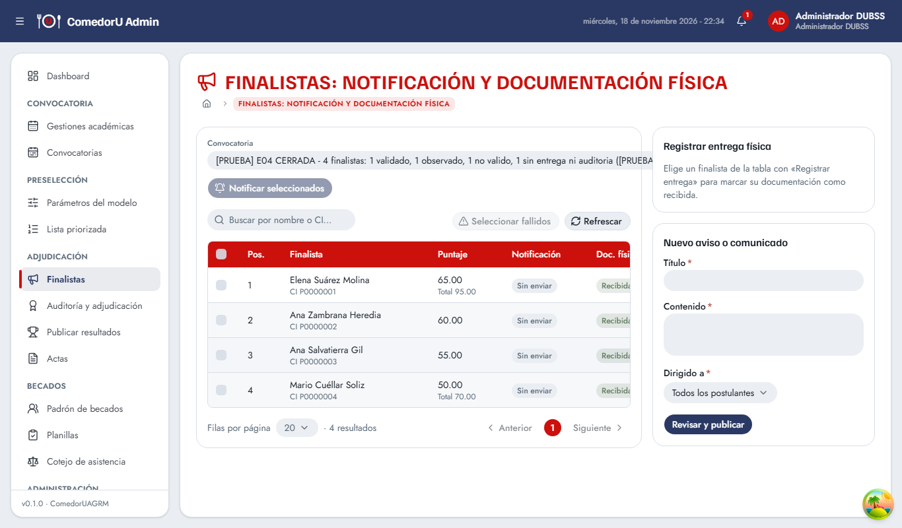
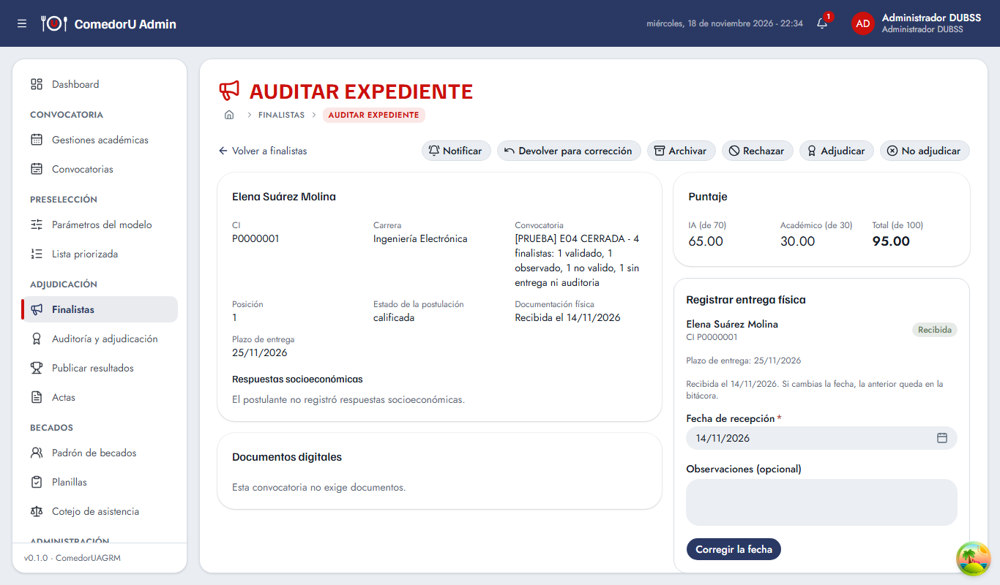
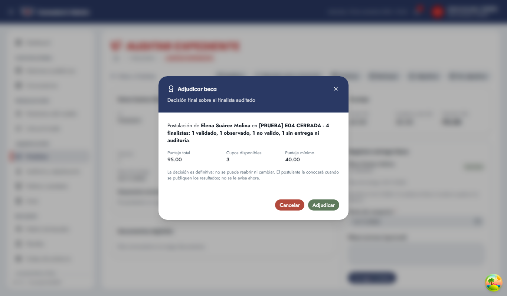
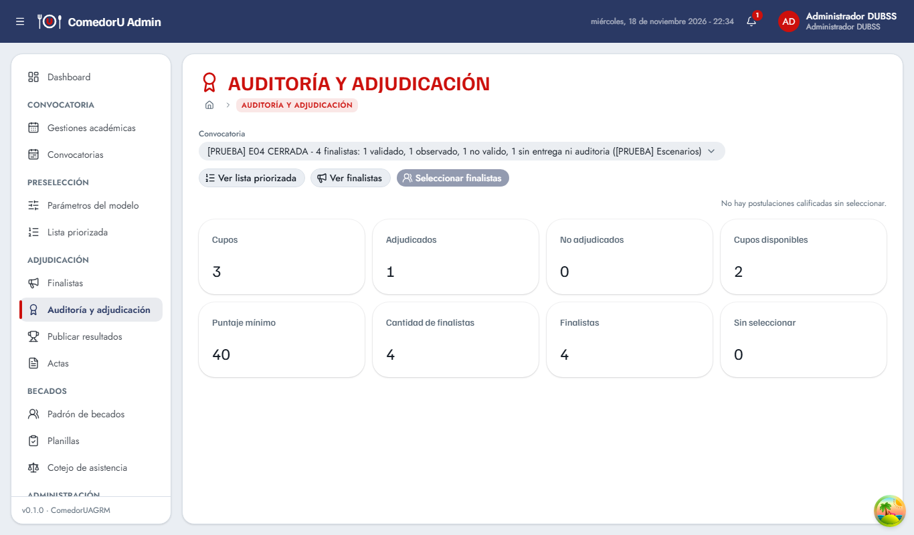

**Flujo 4 — Bitácora (CU-25).** El administrador consulta la bitácora y ve el evento de inicio de sesión.

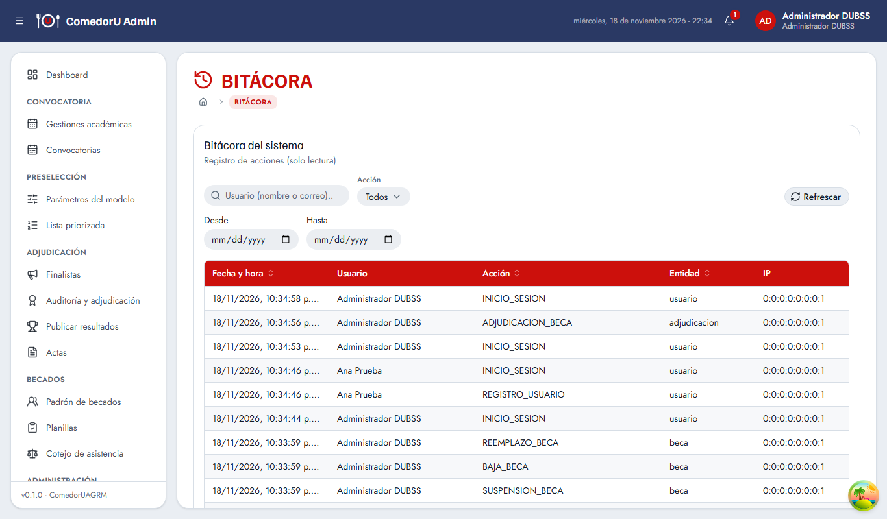

Limitación: el flujo de postulación llega hasta guardar el borrador; no envía la postulación completa con documentos.

### 4.3 Rendimiento con k6

Script: `tests/k6/carga-api.js` (rampa de 10 a 20 usuarios virtuales durante 55 s sobre salud, carreras, convocatorias, indicadores y bitácora; umbrales: menos de 1 % de errores y p95 por debajo de 800 ms). Workflow manual: `.github/workflows/k6.yml` (*Run workflow* en la pestaña Actions; sube `k6-resumen.json`).

**k6 no está instalado en esta máquina y no lo ejecuté aquí, así que no hay resultados de rendimiento que mostrar todavía.** Los números salen de la primera corrida del workflow.

### 4.4 Pipeline de integración continua

`.github/workflows/ci.yml` corre ahora también en pushes a `Mauro`. Cada job sube sus reportes como artefactos: `cobertura-backend-jacoco`, `resultados-backend-surefire`, `cobertura-web-vitest` y `cobertura-movil-flutter`. Bruno y Playwright **no corren en el CI**: se ejecutan en local (ver sección 5), con el backend en perfil `dev`, y su evidencia es la de las secciones 4.1 y 4.2. **El pipeline modificado todavía no se ejecutó en GitHub**: lo validé solo localmente, así que la primera corrida puede pedir ajustes.

---

## 5. Cómo reproducir

```bash
# Backend + cobertura (reporte: projects/backend/comedor-uagrm-core/target/site/jacoco/index.html)
cd projects/backend/comedor-uagrm-core && ./mvnw test
# Web
pnpm --dir projects/frontend/comedoruagrm exec vitest run --coverage
# Móvil
cd projects/mobile && flutter test --coverage
# Bruno y Playwright (con el backend en perfil dev corriendo y el panel en :5173)
cd tests/api-bruno && bru run --env local
cd tests/e2e && npm install && npx playwright install chromium && npx playwright test
# k6
k6 run -e BASE_URL=http://localhost:8080 tests/k6/carga-api.js
```

---

## 6. Calidad estática

El análisis de calidad (bugs, vulnerabilidades, duplicación) se hace por fuera del repositorio con SonarCloud (sonarcloud.io), conectado directamente al repo de GitHub; el repositorio no contiene configuración de Sonar.
