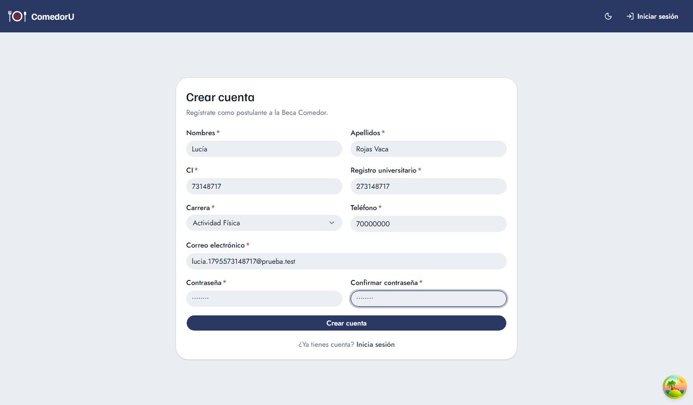
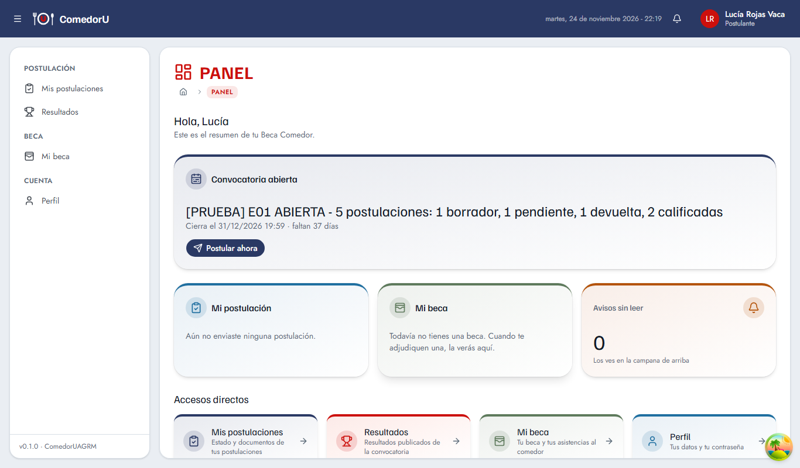
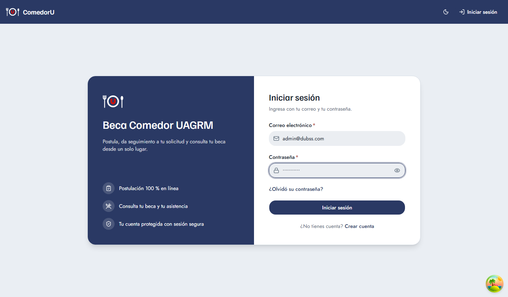
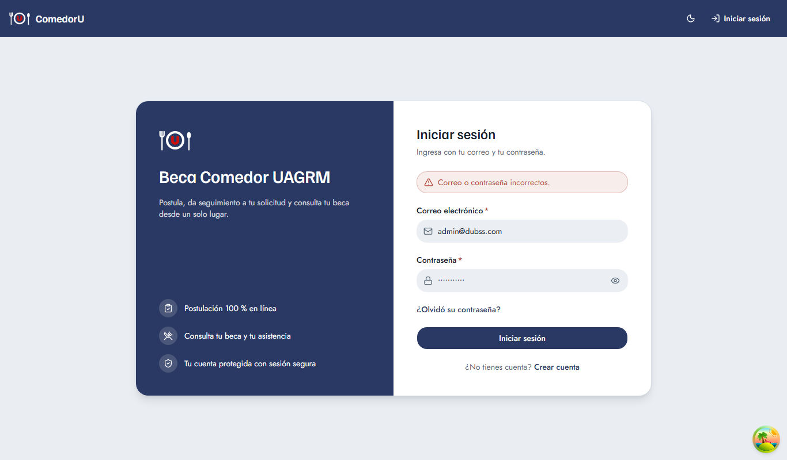
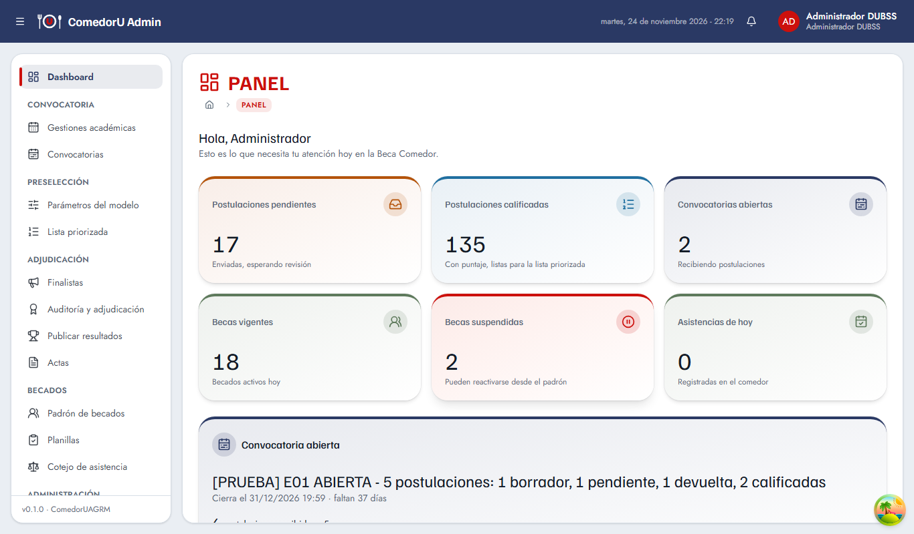
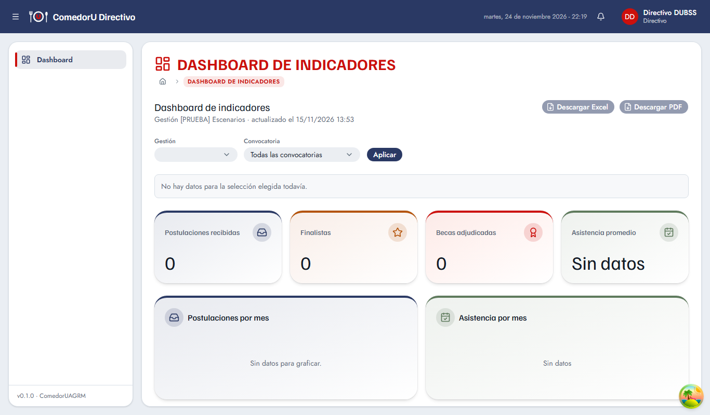

# CU-01. Registrarse y autenticarse

Estructura de la tabla: sección 9.2.1 del documento de taller. Entorno: web en `http://localhost` (proxy nginx) y API en `http://localhost:8080`. Capturas en `capturas/CU01/`.

### Caso A

| Campo | Contenido |
| --- | --- |
| Nombre del caso de prueba | CU-01. Registrarse y autenticarse (registro de postulante) |
| Descripción | El estudiante crea su cuenta con sus datos personales y académicos; el sistema abre la sesión y lo lleva a su módulo. |
| Precondición | Ninguna sesión abierta. El CI, el correo y el registro universitario no existen en el sistema. |
| Datos de entrada | Nombres «Lucía», apellidos «Rojas Vaca», CI y registro universitario únicos generados para la prueba, primera carrera de la lista, teléfono 70000000, correo `lucia.<marca>@prueba.test`, contraseña «Clave123» y su confirmación. |
| Condición de ejecución | No aplica |
| Captura de imagen inicial |  |
| Pasos | 1. Abrir `/registro`. 2. Completar todos los campos del formulario. 3. Pulsar «Crear cuenta». |
| Resultado esperado | Se crea la cuenta con rol Postulante, se abre la sesión y se muestra el panel del postulante. |
| Resultado obtenido | La cuenta se creó y la aplicación quedó en `/panel` con el saludo «Hola, Lucía» y la convocatoria abierta con el botón «Postular ahora». |
| Captura de imagen final |  |
| Resultado de prueba | **Correcto** |

### Caso B

| Campo | Contenido |
| --- | --- |
| Nombre del caso de prueba | CU-01. Registrarse y autenticarse (credenciales inválidas) |
| Descripción | El sistema rechaza el acceso cuando la contraseña no corresponde, sin revelar cuál dato falló. |
| Precondición | Existe la cuenta `admin@dubss.com`. |
| Datos de entrada | Correo `admin@dubss.com`, contraseña «incorrecta1». |
| Condición de ejecución | No aplica |
| Captura de imagen inicial |  |
| Pasos | 1. Abrir `/login`. 2. Escribir el correo y la contraseña incorrecta. 3. Pulsar «Iniciar sesión». |
| Resultado esperado | No se abre la sesión y se muestra un mensaje genérico de credenciales incorrectas. |
| Resultado obtenido | Se permaneció en `/login` y apareció el mensaje «Correo o contraseña incorrectos.». |
| Captura de imagen final |  |
| Resultado de prueba | **Correcto** |

### Caso C

| Campo | Contenido |
| --- | --- |
| Nombre del caso de prueba | CU-01. Registrarse y autenticarse (inicio de sesión) |
| Descripción | Con credenciales válidas el sistema abre la sesión y redirige al módulo del rol. |
| Precondición | Existe la cuenta del Administrador DUBSS sembrada (`admin@dubss.com`). |
| Datos de entrada | Correo `admin@dubss.com`, contraseña de desarrollo. |
| Condición de ejecución | No aplica |
| Captura de imagen inicial |  |
| Pasos | 1. Abrir `/login`. 2. Escribir las credenciales. 3. Pulsar «Iniciar sesión». |
| Resultado esperado | Se abre la sesión y se muestra el panel del administrador. |
| Resultado obtenido | La aplicación redirigió a `/panel` con el panel del administrador. |
| Captura de imagen final |  |
| Resultado de prueba | **Correcto** |

### Caso D

| Campo | Contenido |
| --- | --- |
| Nombre del caso de prueba | CU-01. Registrarse y autenticarse (redirección por rol) |
| Descripción | Cada rol llega a su propio módulo después de iniciar sesión. |
| Precondición | Existe la cuenta `directivo@dubss.com`. |
| Datos de entrada | Correo `directivo@dubss.com`, contraseña de desarrollo. |
| Condición de ejecución | No aplica |
| Captura de imagen inicial | No aplica: la prueba comprueba un estado y no tiene pantalla previa distinta de la final. |
| Pasos | 1. Abrir `/login`. 2. Escribir las credenciales del directivo. 3. Pulsar «Iniciar sesión». |
| Resultado esperado | El directivo llega a su dashboard. |
| Resultado obtenido | La aplicación redirigió a `/dashboard` (menú con solo «Dashboard»). |
| Captura de imagen final |  |
| Resultado de prueba | **Correcto** |
