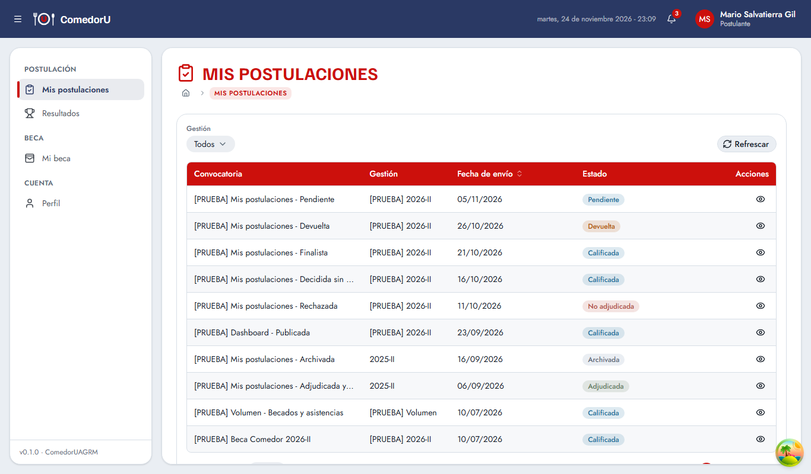
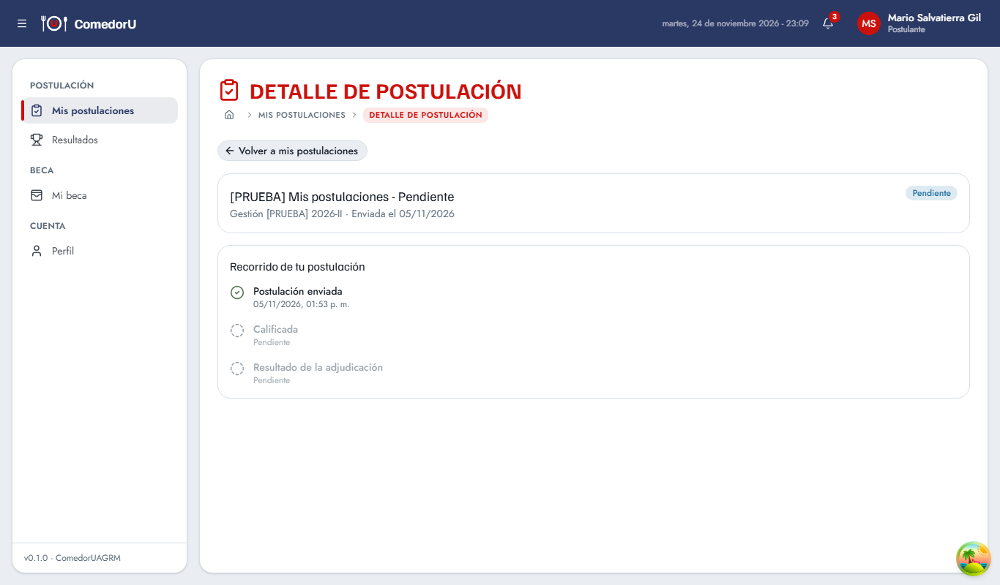
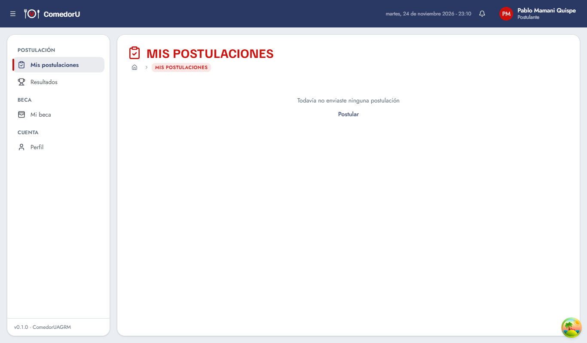

# CU-04. Consultar estado de postulación

Estructura de la tabla: sección 9.2.1 del documento de taller. Entorno: web en `http://localhost` (proxy nginx) y API en `http://localhost:8080`. Capturas en `capturas/CU04/`.

### Caso A

| Campo | Contenido |
| --- | --- |
| Nombre del caso de prueba | CU-04. Consultar estado de postulación (lista y detalle) |
| Descripción | El postulante ve sus postulaciones enviadas con su estado y el recorrido de cada una. |
| Precondición | Sesión de `postulante.finalista@prueba.local` con postulaciones sembradas en varios estados. |
| Datos de entrada | Ninguno. |
| Condición de ejecución | No aplica |
| Captura de imagen inicial |  |
| Pasos | 1. Abrir «Mis postulaciones». 2. Pulsar «Ver» en la primera postulación. |
| Resultado esperado | La lista muestra convocatoria, gestión, fecha de envío y estado; el detalle muestra el recorrido de la postulación. |
| Resultado obtenido | La lista mostró las postulaciones de más reciente a más antigua (Pendiente, Devuelta, Calificada, No adjudicada…). El detalle de «Mis postulaciones - Pendiente» mostró «Recorrido de tu postulación» con «Postulación enviada 05/11/2026». |
| Captura de imagen final |  |
| Resultado de prueba | **Correcto** |

### Caso B

| Campo | Contenido |
| --- | --- |
| Nombre del caso de prueba | CU-04. Consultar estado de postulación (sin postulaciones) |
| Descripción | Si no hay postulaciones enviadas, el sistema lo informa. |
| Precondición | Cuenta de postulante recién creada. |
| Datos de entrada | Ninguno. |
| Condición de ejecución | No aplica |
| Captura de imagen inicial | No aplica: la prueba comprueba un estado y no tiene pantalla previa distinta de la final. |
| Pasos | 1. Abrir «Mis postulaciones». |
| Resultado esperado | Mensaje informativo con la opción de postular. |
| Resultado obtenido | Se mostró «Todavía no enviaste ninguna postulación» y el botón «Postular». |
| Captura de imagen final |  |
| Resultado de prueba | **Correcto** |
