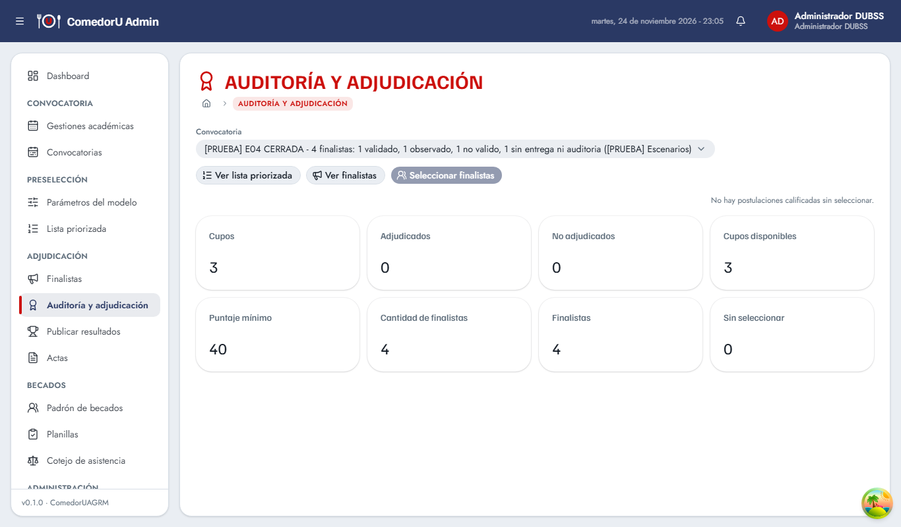
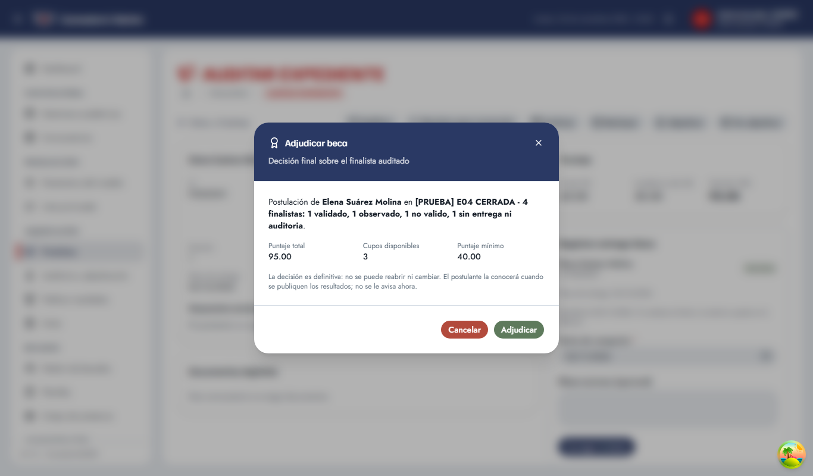
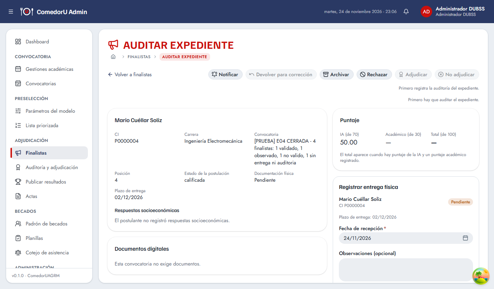
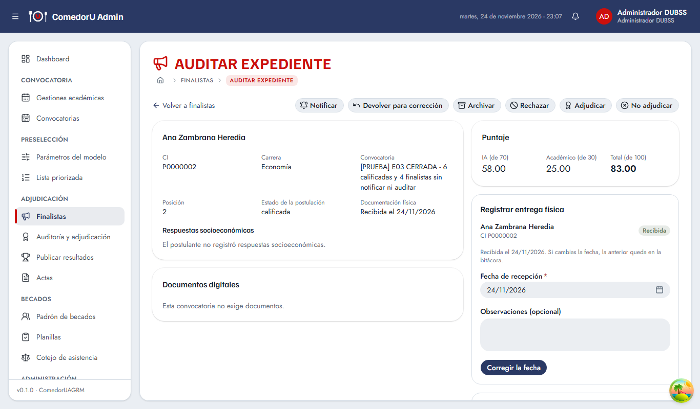
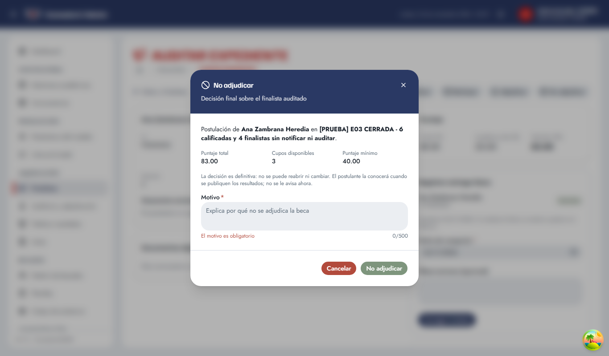

# CU-05. Auditar y adjudicar becas

Estructura de la tabla: sección 9.2.1 del documento de taller. Entorno: web en `http://localhost` (proxy nginx) y API en `http://localhost:8080`. Capturas en `capturas/CU05/`.

### Caso A

| Campo | Contenido |
| --- | --- |
| Nombre del caso de prueba | CU-05. Auditar y adjudicar becas (adjudicación) |
| Descripción | El administrador adjudica la beca al finalista validado, dentro de los cupos y sobre el puntaje mínimo. |
| Precondición | Convocatoria sembrada «[PRUEBA] E04»: 3 cupos, puntaje mínimo 40; finalista 1 (Elena Suárez Molina) validado. |
| Datos de entrada | Finalista 1 de E04; sin datos adicionales. |
| Condición de ejecución | El expediente debe estar auditado como «Validado», con puntaje total mayor o igual al mínimo y cupos libres. |
| Captura de imagen inicial |  |
| Pasos | 1. Abrir «Auditoría y adjudicación», elegir E04 y ver el panel. 2. Abrir el expediente del finalista 1 y pulsar «Adjudicar». 3. Revisar la ventana de confirmación y pulsar «Adjudicar». 4. Volver al panel de E04. |
| Resultado esperado | La postulación queda «adjudicada» y los cupos disponibles bajan en uno. |
| Resultado obtenido | Antes: cupos 3, adjudicados 0, disponibles 3. La ventana mostró puntaje total 95,00, cupos disponibles 3, mínimo 40,00. Después: estado «adjudicada», adjudicados 1 y cupos disponibles 2. |
| Captura de imagen final |   |
| Resultado de prueba | **Correcto** |

### Caso B

| Campo | Contenido |
| --- | --- |
| Nombre del caso de prueba | CU-05. Auditar y adjudicar becas (sin auditoría) |
| Descripción | No se puede decidir sobre un finalista sin auditoría. |
| Precondición | Finalista 4 de E04 sin entrega ni auditoría. |
| Datos de entrada | Expediente del finalista 4. |
| Condición de ejecución | No aplica |
| Captura de imagen inicial |  |
| Pasos | 1. Abrir el expediente del finalista 4 de E04. 2. Intentar pulsar «Adjudicar» y «No adjudicar». |
| Resultado esperado | Las dos decisiones no están disponibles y se pide auditar primero. |
| Resultado obtenido | Los botones «Adjudicar» y «No adjudicar» estaban deshabilitados con los avisos «Primero registra la auditoría del expediente.» y «Primero hay que auditar el expediente.». |
| Captura de imagen final |  |
| Resultado de prueba | **Correcto** |

### Caso C

| Campo | Contenido |
| --- | --- |
| Nombre del caso de prueba | CU-05. Auditar y adjudicar becas (motivo de no adjudicación) |
| Descripción | La no adjudicación exige un motivo. |
| Precondición | Finalista 2 (Ana Zambrana Heredia) de «[PRUEBA] E03», validado, puntaje total 83,00. |
| Datos de entrada | Motivo vacío. |
| Condición de ejecución | No aplica |
| Captura de imagen inicial |  |
| Pasos | 1. Abrir el expediente y pulsar «No adjudicar». 2. Pulsar «No adjudicar» en la ventana sin escribir el motivo. |
| Resultado esperado | No se registra la decisión y se muestra que el motivo es obligatorio. |
| Resultado obtenido | La ventana siguió abierta con «El motivo es obligatorio» (puntaje total 83,00, cupos disponibles 3, mínimo 40,00). |
| Captura de imagen final |  |
| Resultado de prueba | **Correcto** |
