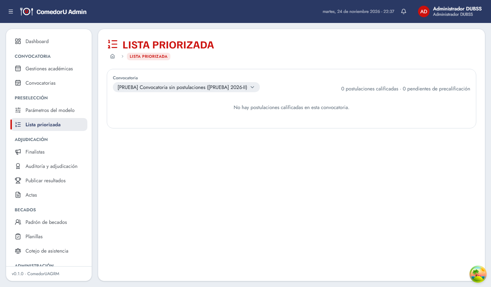
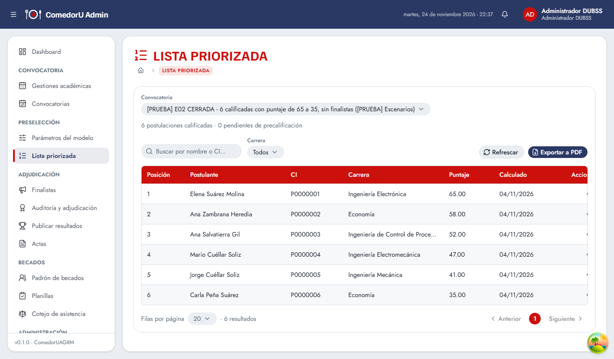
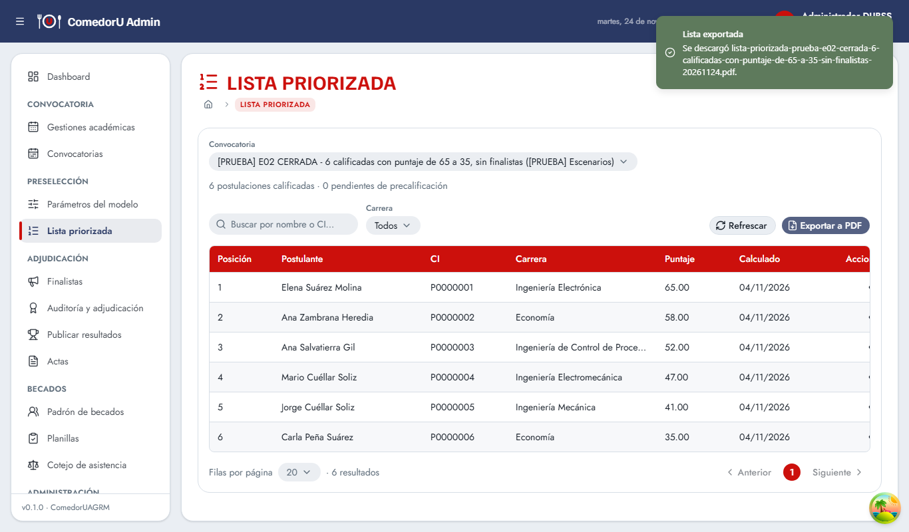
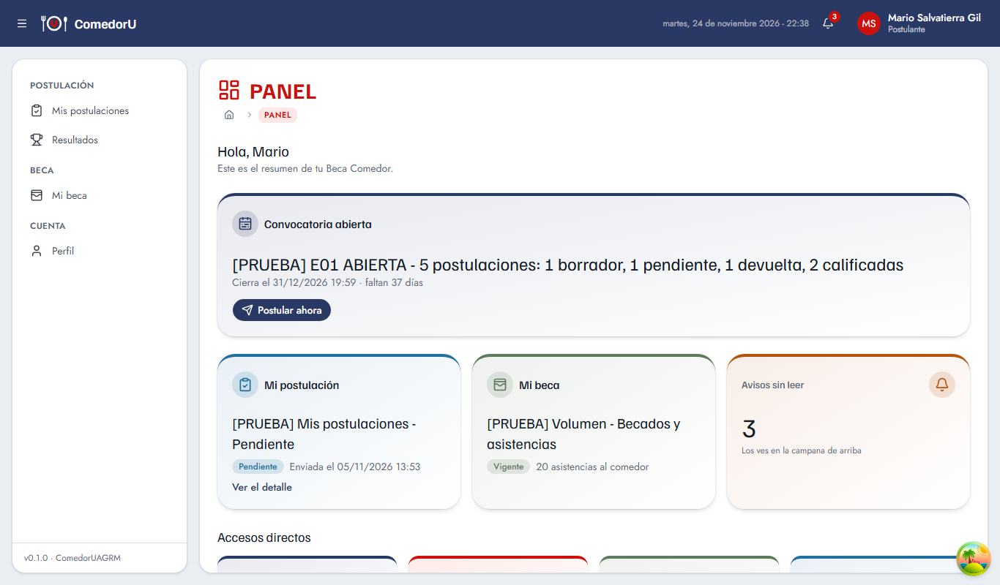

# CU-06. Visualizar lista priorizada de postulantes

Estructura de la tabla: sección 9.2.1 del documento de taller. Entorno: web en `http://localhost` (proxy nginx) y API en `http://localhost:8080`. Capturas en `capturas/CU06/`.

### Caso A

| Campo | Contenido |
| --- | --- |
| Nombre del caso de prueba | CU-06. Visualizar lista priorizada de postulantes (consulta y exportación) |
| Descripción | El administrador consulta las postulaciones calificadas ordenadas por puntaje y exporta la lista completa. |
| Precondición | Sesión del Administrador DUBSS. Convocatoria sembrada «[PRUEBA] E02 CERRADA» con 6 postulaciones calificadas (puntajes de 65 a 35). |
| Datos de entrada | Convocatoria E02. Sin búsqueda ni filtro por carrera. |
| Condición de ejecución | No aplica |
| Captura de imagen inicial |  |
| Pasos | 1. Abrir «Lista priorizada». 2. Elegir la convocatoria E02. 3. Revisar la tabla y pulsar «Exportar a PDF». |
| Resultado esperado | La tabla muestra posición, postulante, CI, carrera, puntaje y fecha de cálculo de mayor a menor puntaje, y se descarga un PDF con la lista. |
| Resultado obtenido | Se listaron 6 postulaciones en orden 65, 58, 52, 47, 41 y 35 con posiciones 1 a 6 («6 postulaciones calificadas · 0 pendientes de precalificación»). Se descargó `lista-priorizada-prueba-e02-...-20261124.pdf` (80 028 bytes) y apareció el aviso «Lista exportada». |
| Captura de imagen final |   |
| Resultado de prueba | **Correcto** |

### Caso B

| Campo | Contenido |
| --- | --- |
| Nombre del caso de prueba | CU-06. Visualizar lista priorizada de postulantes (lista vacía) |
| Descripción | El sistema informa cuando la convocatoria no tiene postulaciones calificadas. |
| Precondición | Sesión del administrador. Convocatoria «[PRUEBA] Convocatoria sin postulaciones». |
| Datos de entrada | Convocatoria «sin postulaciones». |
| Condición de ejecución | No aplica |
| Captura de imagen inicial | No aplica: la prueba comprueba un estado y no tiene pantalla previa distinta de la final. |
| Pasos | 1. Abrir «Lista priorizada». 2. Elegir la convocatoria sin postulaciones. |
| Resultado esperado | Se muestra un mensaje informativo y no se muestra la tabla. |
| Resultado obtenido | Se mostró «0 postulaciones calificadas · 0 pendientes de precalificación» y «No hay postulaciones calificadas en esta convocatoria.». |
| Captura de imagen final |  |
| Resultado de prueba | **Correcto** |

### Caso C

| Campo | Contenido |
| --- | --- |
| Nombre del caso de prueba | CU-06. Visualizar lista priorizada de postulantes (control de acceso) |
| Descripción | Solo el administrador puede ver la lista. |
| Precondición | Sesión del postulante `postulante.finalista@prueba.local`. |
| Datos de entrada | Ruta `/lista-priorizada`. |
| Condición de ejecución | No aplica |
| Captura de imagen inicial | No aplica: la prueba comprueba un estado y no tiene pantalla previa distinta de la final. |
| Pasos | 1. Iniciar sesión como postulante. 2. Escribir en el navegador la ruta `/lista-priorizada`. |
| Resultado esperado | El sistema no muestra la pantalla y devuelve al postulante a su módulo. |
| Resultado obtenido | La aplicación redirigió a `/panel`. |
| Captura de imagen final |  |
| Resultado de prueba | **Correcto** |
