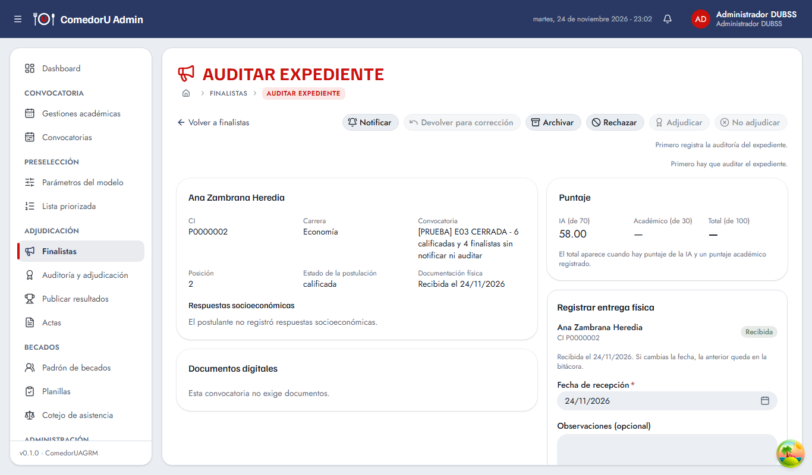
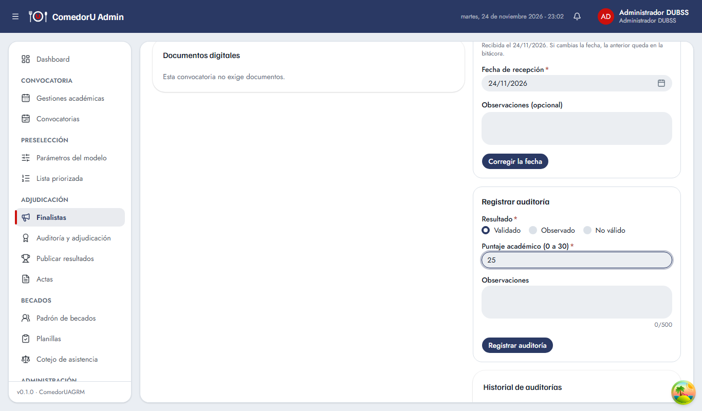
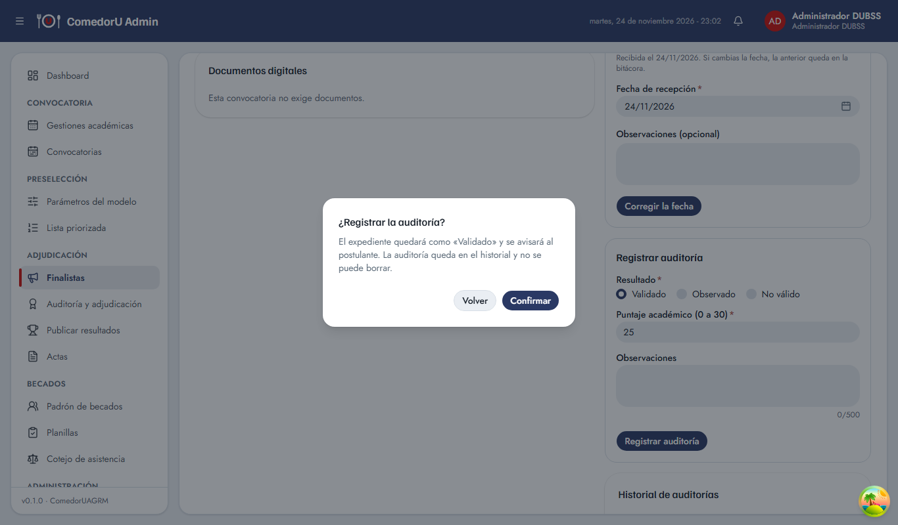
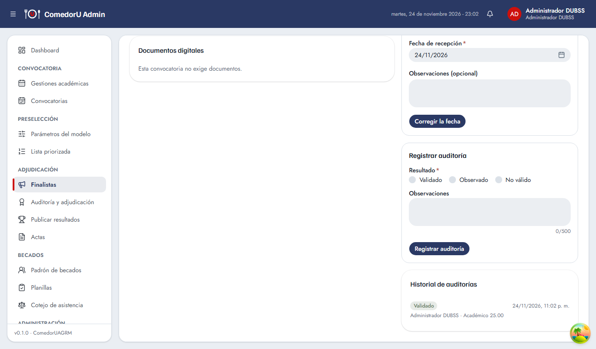
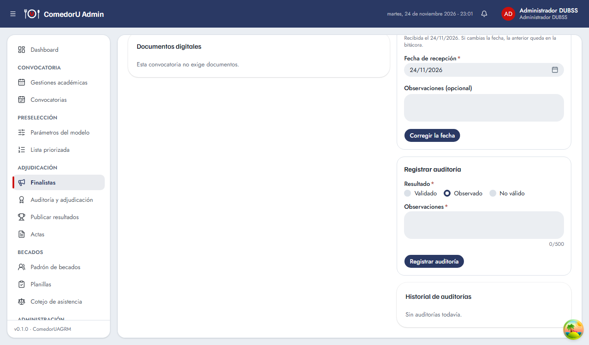
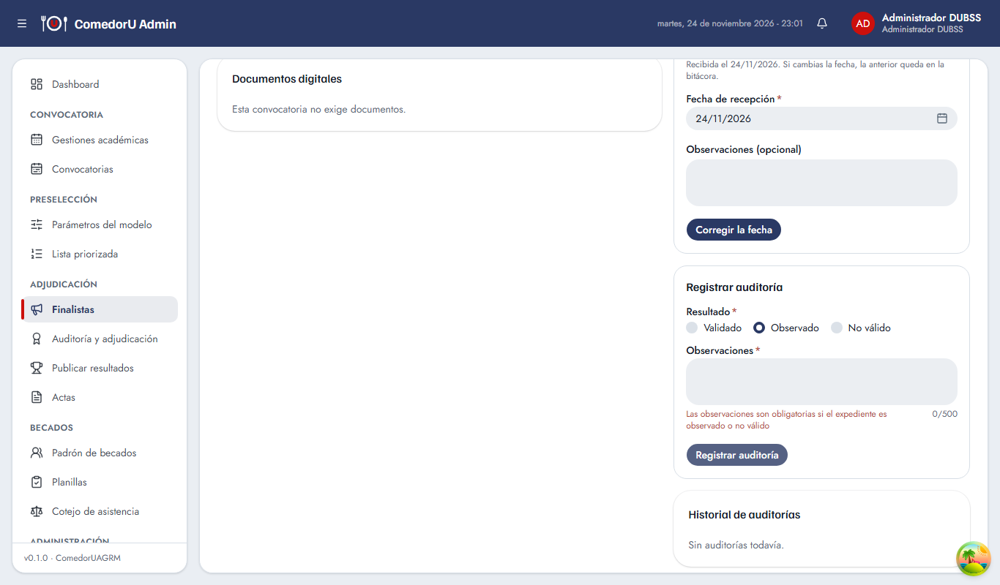
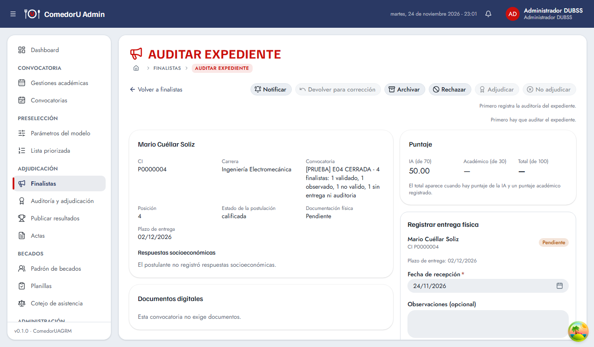

# CU-07. Auditar expediente finalista

Estructura de la tabla: sección 9.2.1 del documento de taller. Entorno: web en `http://localhost` (proxy nginx) y API en `http://localhost:8080`. Capturas en `capturas/CU07/`.

### Caso A

| Campo | Contenido |
| --- | --- |
| Nombre del caso de prueba | CU-07. Auditar expediente finalista (validación) |
| Descripción | El administrador revisa el expediente de un finalista, registra la recepción de su documentación y lo audita con puntaje académico. |
| Precondición | Sesión del administrador. Finalista 2 (Ana Zambrana Heredia) de «[PRUEBA] E03», calificada, sin auditoría. |
| Datos de entrada | Fecha de recepción de hoy, resultado «Validado», puntaje académico 25. |
| Condición de ejecución | La documentación física debe estar registrada antes de auditar; el puntaje académico va de 0 a 30. |
| Captura de imagen inicial |  |
| Pasos | 1. Abrir «Finalistas», elegir E03 y pulsar «Auditar» en Ana Zambrana. 2. Registrar la entrega física («Marcar como recibida»). 3. Elegir «Validado» y escribir 25 como puntaje académico. 4. Pulsar «Registrar auditoría» y «Confirmar». |
| Resultado esperado | La auditoría queda en el historial y el total es el puntaje de la IA más el académico. |
| Resultado obtenido | Puntaje IA 58,00, académico 25,00 y total 83,00; el historial muestra «Validado … Administrador DUBSS · Académico 25.00». Nota: la entrega física ya estaba registrada cuando se tomó esta captura (un intento previo de la prueba la había registrado), por eso la captura inicial ya la muestra. |
| Captura de imagen final |    |
| Resultado de prueba | **Correcto** |

### Caso B

| Campo | Contenido |
| --- | --- |
| Nombre del caso de prueba | CU-07. Auditar expediente finalista (observaciones obligatorias) |
| Descripción | Un expediente observado exige observaciones. |
| Precondición | Finalista 3 (Ana Salvatierra Gil) de E03 con entrega registrada. |
| Datos de entrada | Resultado «Observado» y el campo Observaciones vacío. |
| Condición de ejecución | No aplica |
| Captura de imagen inicial |  |
| Pasos | 1. Abrir el expediente de Ana Salvatierra y registrar la entrega. 2. Elegir «Observado» y dejar vacío «Observaciones». 3. Pulsar «Registrar auditoría». |
| Resultado esperado | No se registra la auditoría y se indica que las observaciones son obligatorias. |
| Resultado obtenido | El formulario mostró «Las observaciones son obligatorias si el expediente es observado…» y el historial siguió con «Sin auditorías todavía». |
| Captura de imagen final |  |
| Resultado de prueba | **Correcto** |

### Caso C

| Campo | Contenido |
| --- | --- |
| Nombre del caso de prueba | CU-07. Auditar expediente finalista (entrega pendiente) |
| Descripción | No se puede auditar un expediente cuya documentación física no se recibió. |
| Precondición | Finalista 4 de «[PRUEBA] E04», sin entrega ni auditoría. |
| Datos de entrada | Expediente del finalista 4. |
| Condición de ejecución | No aplica |
| Captura de imagen inicial | No aplica: la prueba comprueba un estado y no tiene pantalla previa distinta de la final. |
| Pasos | 1. Abrir «Finalistas», elegir E04 y «Auditar» en el finalista 4. 2. Observar el formulario de auditoría. |
| Resultado esperado | El botón «Registrar auditoría» no está disponible y se pide registrar antes la entrega. |
| Resultado obtenido | Documentación física «Pendiente», aviso «Primero registra la entrega de la documentación física.» y botón «Registrar auditoría» deshabilitado. |
| Captura de imagen final |  |
| Resultado de prueba | **Correcto** |
