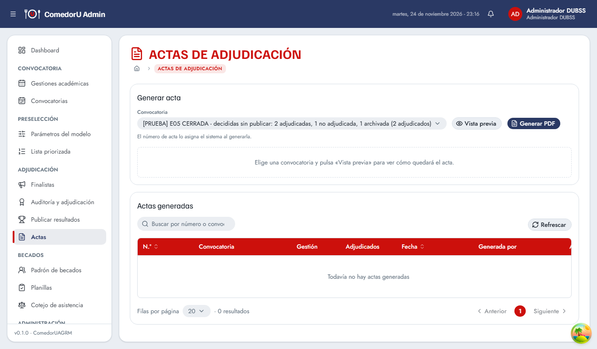
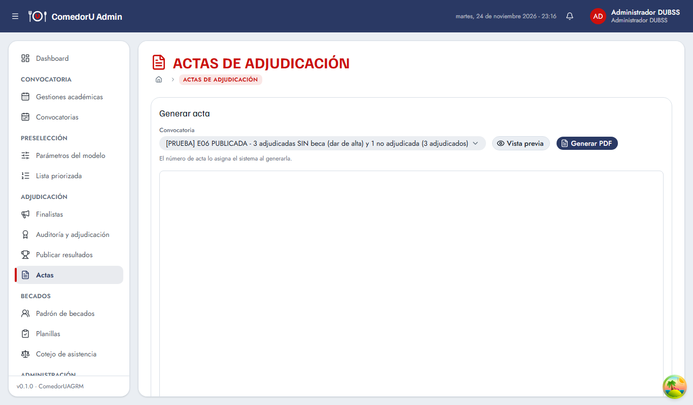
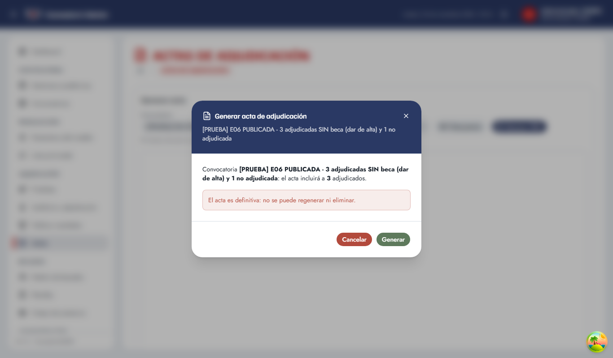
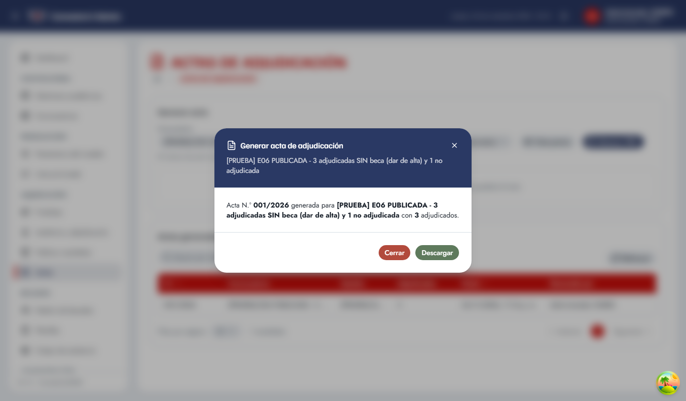
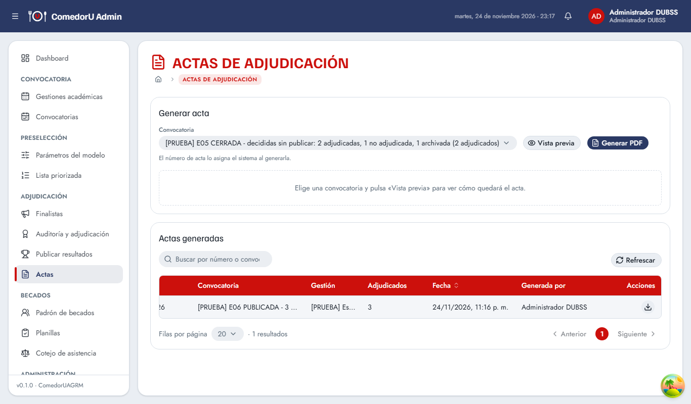
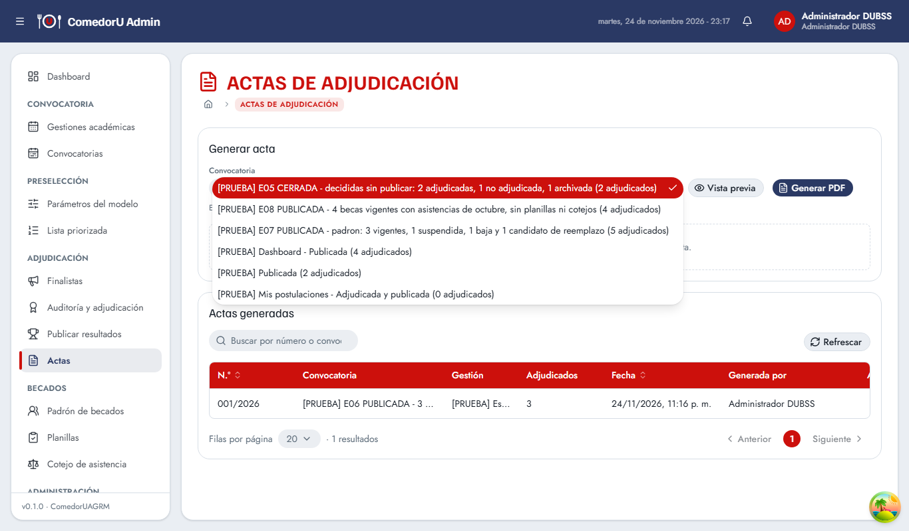

# CU-08. Generar acta de adjudicación

Estructura de la tabla: sección 9.2.1 del documento de taller. Entorno: web en `http://localhost` (proxy nginx) y API en `http://localhost:8080`. Capturas en `capturas/CU08/`.

### Caso A

| Campo | Contenido |
| --- | --- |
| Nombre del caso de prueba | CU-08. Generar acta de adjudicación (generación) |
| Descripción | El administrador genera el acta definitiva en PDF con número automático para una convocatoria con resultados publicados. |
| Precondición | Convocatoria sembrada «[PRUEBA] E06», publicada y sin acta (3 adjudicados). MinIO activo. |
| Datos de entrada | Convocatoria E06. |
| Condición de ejecución | El acta es definitiva: no se puede regenerar ni eliminar. |
| Captura de imagen inicial |  |
| Pasos | 1. Abrir «Actas» y elegir E06. 2. Pulsar «Vista previa». 3. Pulsar «Generar PDF» y confirmar con «Generar». |
| Resultado esperado | Se genera el acta con número `NNN/AAAA` y aparece en la tabla de actas generadas. |
| Resultado obtenido | **Primer intento: falló.** La pantalla mostró «Ocurrió un error en el servidor» porque el backend no pudo subir el PDF a MinIO: el `.env` local usa las credenciales `admin` / `admin12345` y el contenedor `core` no las recibe, de modo que el backend usa las predeterminadas (`minio_admin`). Fue un desajuste del entorno, no de la lógica del caso: se creó en MinIO el usuario `minio_admin` y se repitió la prueba. **Segundo intento:** la tabla muestra el acta `001/2026`, 3 adjudicados, generada por Administrador DUBSS el 24/11/2026. |
| Captura de imagen final |    |
| Resultado de prueba | **Correcto (tras corregir el entorno de MinIO)** |

### Caso B

| Campo | Contenido |
| --- | --- |
| Nombre del caso de prueba | CU-08. Generar acta de adjudicación (descarga) |
| Descripción | El administrador descarga el PDF del acta generada. |
| Precondición | Acta 001/2026 generada. |
| Datos de entrada | Acción «Descargar» de la fila del acta. |
| Condición de ejecución | No aplica |
| Captura de imagen inicial | No aplica: la prueba comprueba un estado y no tiene pantalla previa distinta de la final. |
| Pasos | 1. En «Actas», pulsar «Descargar» en la fila del acta 001/2026. |
| Resultado esperado | Se descarga un PDF con el acta y los adjudicados. |
| Resultado obtenido | Se descargó `acta-001-2026.pdf` (79 735 bytes). Contiene «Acta de adjudicación», N.º 001/2026, cupos 3, puntaje mínimo 40,00 y a los 3 adjudicados con CI, carrera y puntaje final 95,00. El nombre largo de la convocatoria de prueba aparece cortado en el encabezado. |
| Captura de imagen final |  |
| Resultado de prueba | **Correcto** |

### Caso C

| Campo | Contenido |
| --- | --- |
| Nombre del caso de prueba | CU-08. Generar acta de adjudicación (convocatoria sin resultados publicados) |
| Descripción | El selector solo ofrece convocatorias con resultados publicados que aún no tienen acta. |
| Precondición | Acta de E06 ya generada. |
| Datos de entrada | Selector de convocatoria. |
| Condición de ejecución | No aplica |
| Captura de imagen inicial | No aplica: la prueba comprueba un estado y no tiene pantalla previa distinta de la final. |
| Pasos | 1. En «Actas», abrir la lista del selector «Convocatoria». |
| Resultado esperado | E06 (ya con acta) y las convocatorias sin resultados publicados no aparecen. |
| Resultado obtenido | El selector ofreció E05, E07, E08 y las convocatorias publicadas sin acta; E06 ya no aparecía. |
| Captura de imagen final |  |
| Resultado de prueba | **Correcto** |
