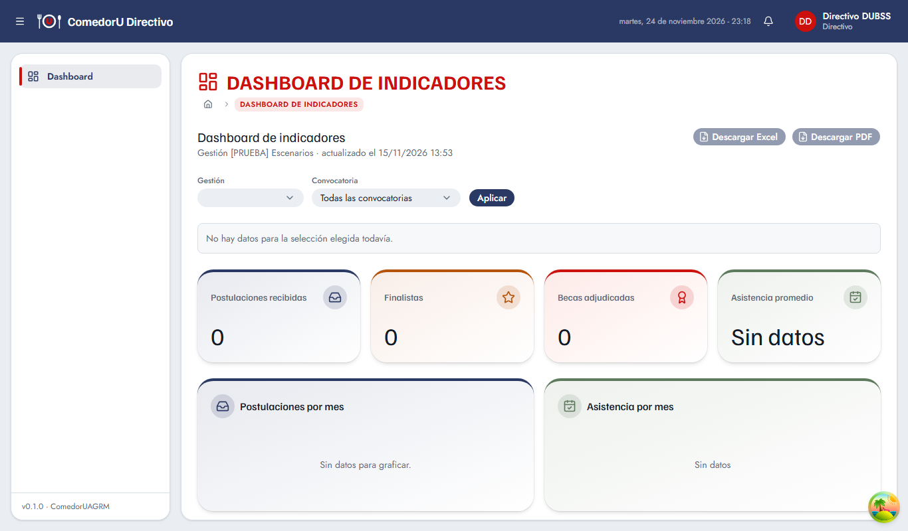
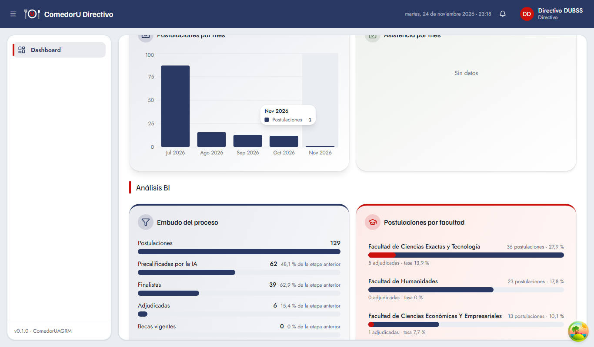
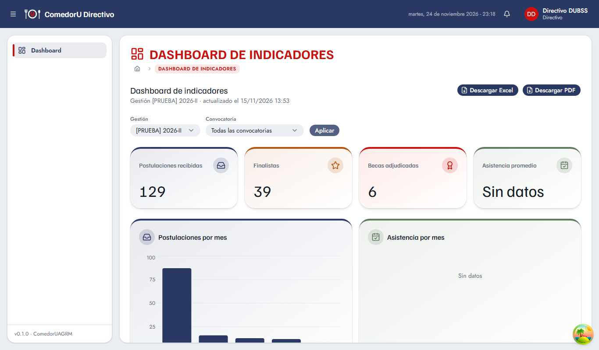
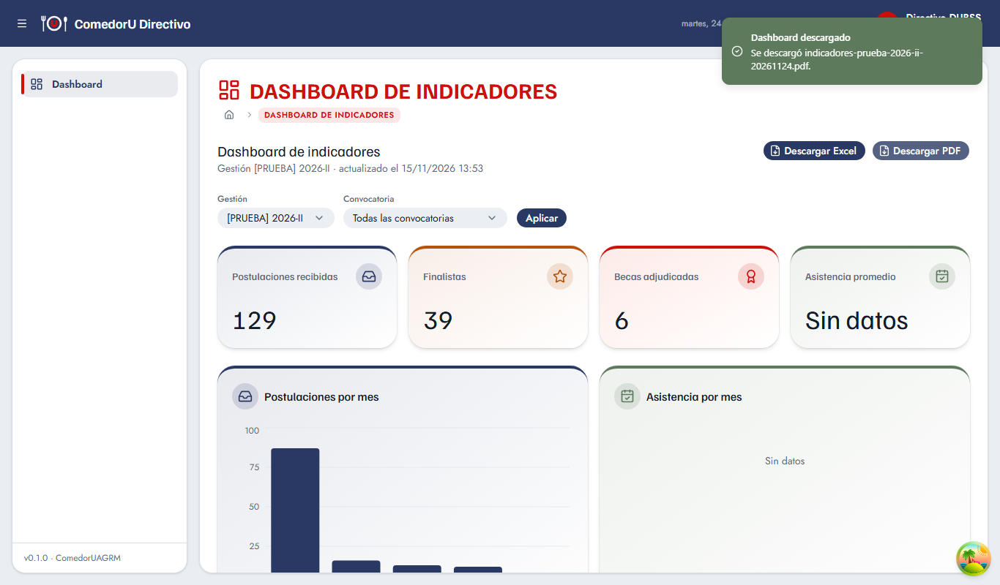
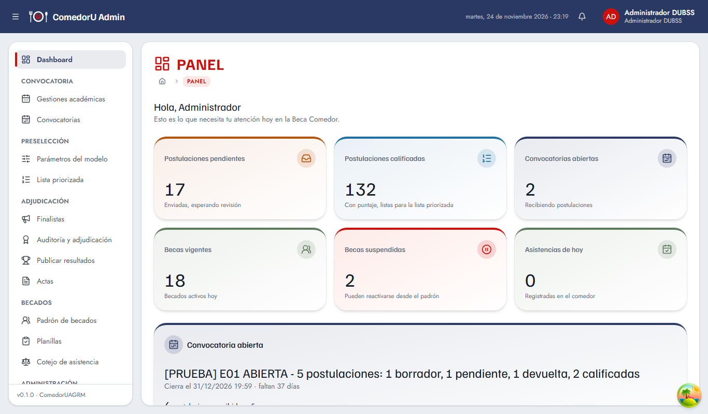

# CU-12. Visualizar dashboard de indicadores BI

Estructura de la tabla: sección 9.2.1 del documento de taller. Entorno: web en `http://localhost` (proxy nginx) y API en `http://localhost:8080`. Capturas en `capturas/CU12/`.

### Caso A

| Campo | Contenido |
| --- | --- |
| Nombre del caso de prueba | CU-12. Visualizar dashboard de indicadores BI (selección sin datos) |
| Descripción | Al abrir el dashboard sin datos para la selección, el sistema lo informa y muestra los indicadores en cero. |
| Precondición | Sesión de `directivo@dubss.com`. |
| Datos de entrada | Selección por defecto (gestión «[PRUEBA] Escenarios»). |
| Condición de ejecución | No aplica |
| Captura de imagen inicial | No aplica: la prueba comprueba un estado y no tiene pantalla previa distinta de la final. |
| Pasos | 1. Iniciar sesión como directivo. 2. Observar el dashboard. |
| Resultado esperado | Mensaje informativo e indicadores en cero (no es un error). |
| Resultado obtenido | Se mostró «No hay datos para la selección elegida todavía.» con todos los indicadores en 0 / «Sin datos». La gestión «Escenarios» se sembró después de la última actualización de los indicadores (15/11/2026 13:53); el refresco programado es a las 02:00. |
| Captura de imagen final |  |
| Resultado de prueba | **Correcto** |

### Caso B

| Campo | Contenido |
| --- | --- |
| Nombre del caso de prueba | CU-12. Visualizar dashboard de indicadores BI (indicadores) |
| Descripción | El directivo filtra por gestión y ve los indicadores, los gráficos y el análisis BI. |
| Precondición | Sesión del directivo. |
| Datos de entrada | Gestión «[PRUEBA] 2026-II», todas las convocatorias. |
| Condición de ejecución | No aplica |
| Captura de imagen inicial |  |
| Pasos | 1. Abrir el selector «Gestión» y elegir «[PRUEBA] 2026-II». 2. Pulsar «Aplicar». 3. Desplazarse hasta «Análisis BI». |
| Resultado esperado | Se actualizan los cuatro indicadores y los gráficos, y aparece el análisis BI. |
| Resultado obtenido | Postulaciones recibidas 129, finalistas 39, becas adjudicadas 6, asistencia promedio «Sin datos»; gráfico de postulaciones por mes (jul a nov 2026) y sección «Análisis BI» con embudo y postulaciones por facultad. |
| Captura de imagen final |   |
| Resultado de prueba | **Correcto** |

### Caso C

| Campo | Contenido |
| --- | --- |
| Nombre del caso de prueba | CU-12. Visualizar dashboard de indicadores BI (exportación a PDF) |
| Descripción | El directivo descarga un PDF con lo que ve en pantalla. |
| Precondición | Gestión «[PRUEBA] 2026-II» aplicada. |
| Datos de entrada | Botón «Descargar PDF». |
| Condición de ejecución | No aplica |
| Captura de imagen inicial |  |
| Pasos | 1. Aplicar la gestión «[PRUEBA] 2026-II». 2. Pulsar «Descargar PDF». |
| Resultado esperado | Se descarga un PDF con los indicadores. |
| Resultado obtenido | Se descargó `indicadores-prueba-2026-ii-20261124.pdf` (310 237 bytes). |
| Captura de imagen final |  |
| Resultado de prueba | **Correcto** |

### Caso D

| Campo | Contenido |
| --- | --- |
| Nombre del caso de prueba | CU-12. Visualizar dashboard de indicadores BI (control de acceso) |
| Descripción | Solo el directivo accede al dashboard. |
| Precondición | Sesión del administrador. |
| Datos de entrada | Ruta `/dashboard`. |
| Condición de ejecución | No aplica |
| Captura de imagen inicial | No aplica: la prueba comprueba un estado y no tiene pantalla previa distinta de la final. |
| Pasos | 1. Iniciar sesión como administrador. 2. Escribir `/dashboard` en el navegador. |
| Resultado esperado | El sistema lo devuelve a su panel. |
| Resultado obtenido | La aplicación redirigió a `/panel`. |
| Captura de imagen final |  |
| Resultado de prueba | **Correcto** |
