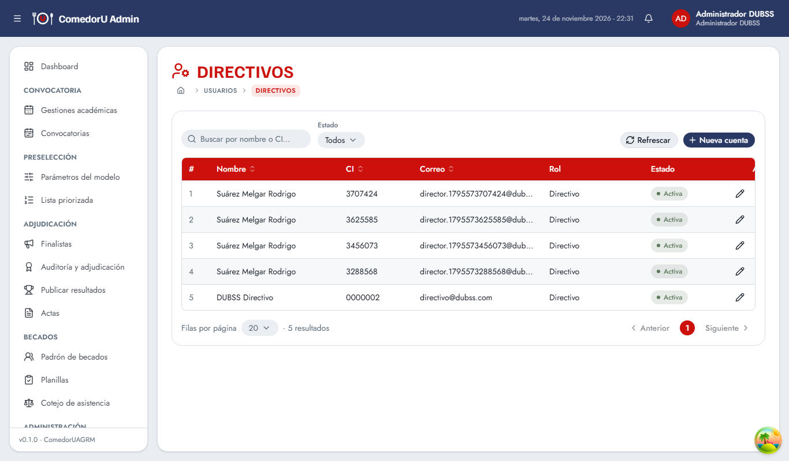
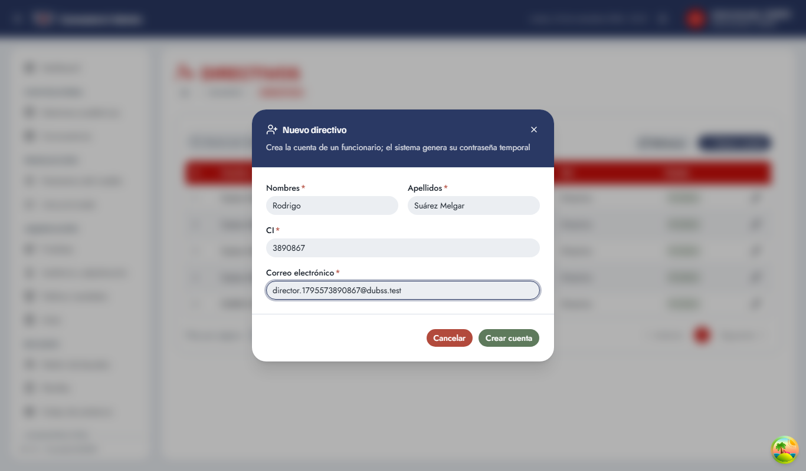
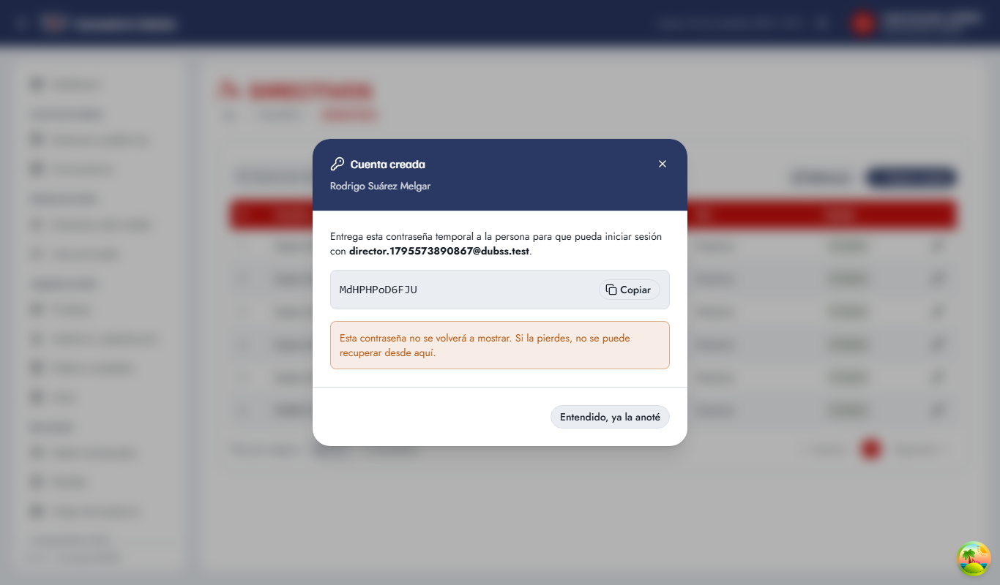
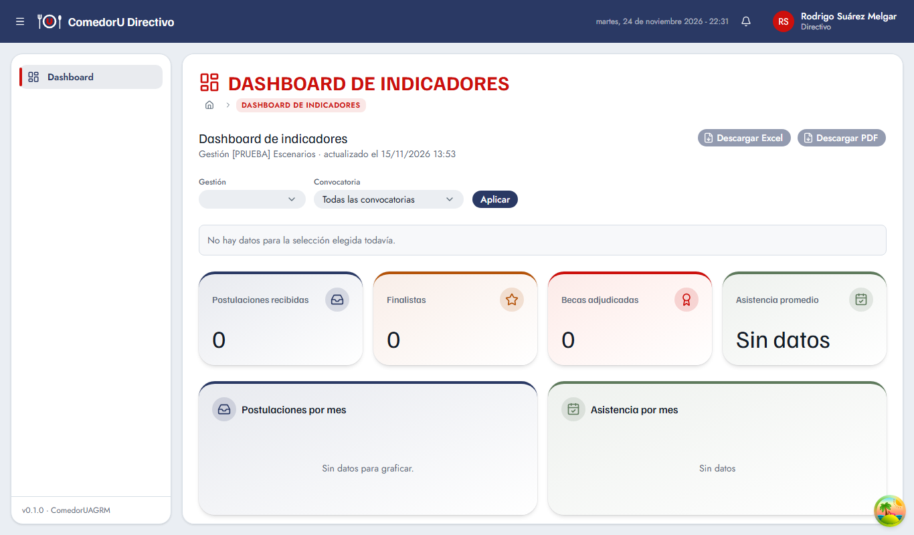
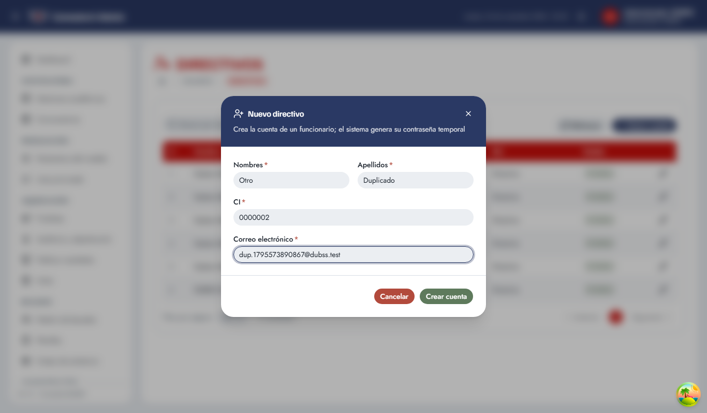
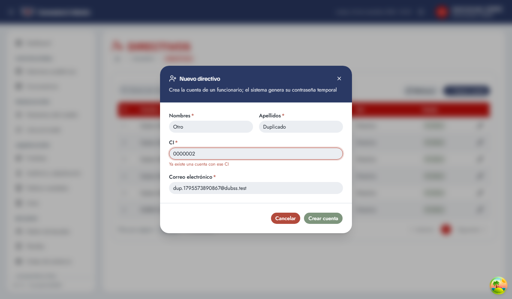
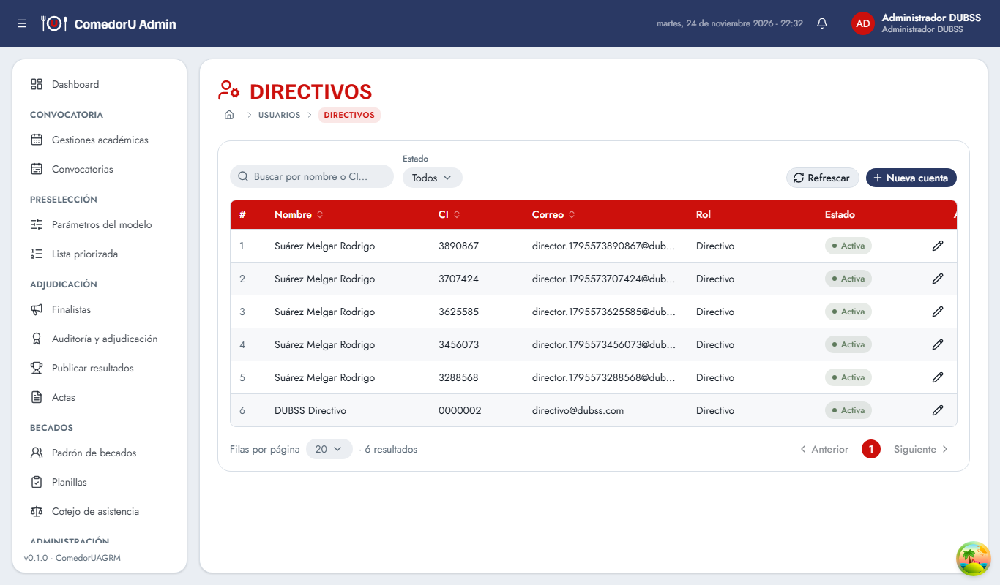
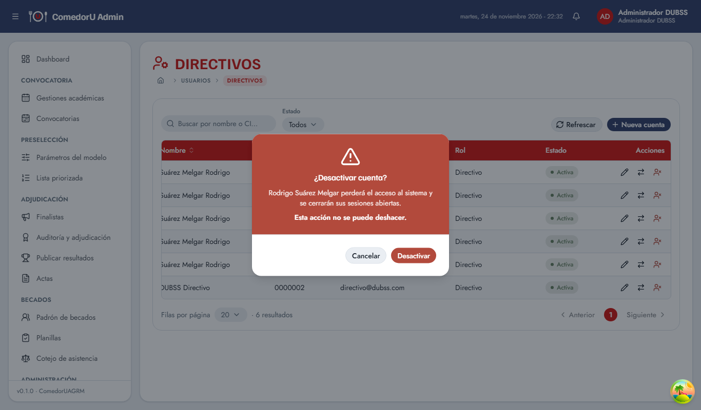
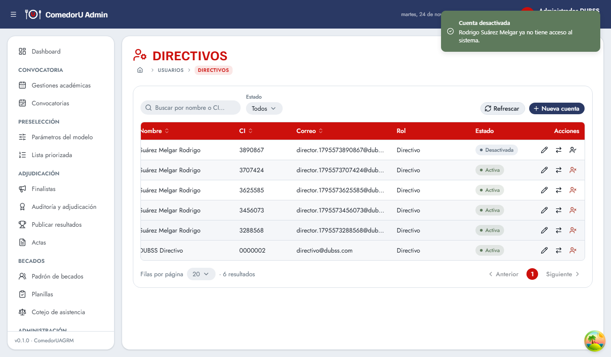
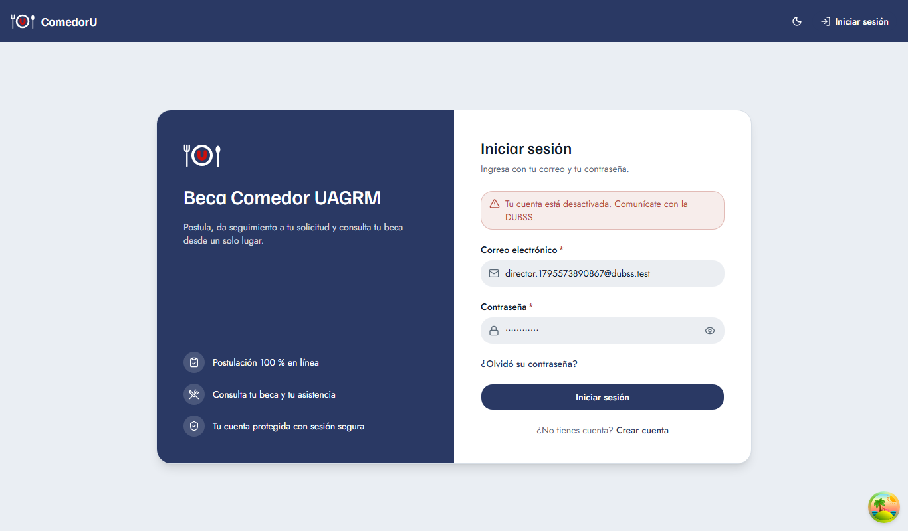

# CU-14. Gestionar usuarios y roles

Estructura de la tabla: sección 9.2.1 del documento de taller. Entorno: web en `http://localhost` (proxy nginx) y API en `http://localhost:8080`. Capturas en `capturas/CU14/`.

### Caso A

| Campo | Contenido |
| --- | --- |
| Nombre del caso de prueba | CU-14. Gestionar usuarios y roles (alta de cuenta) |
| Descripción | El administrador crea una cuenta de personal; el sistema genera una contraseña temporal que se muestra una sola vez. |
| Precondición | Sesión del Administrador DUBSS. Pantalla `/usuarios/directivos`. |
| Datos de entrada | Nombres «Rodrigo», apellidos «Suárez Melgar», CI y correo únicos generados para la prueba. |
| Condición de ejecución | No aplica |
| Captura de imagen inicial |  |
| Pasos | 1. Abrir «Directivos» en el menú. 2. Pulsar «Nueva cuenta» y completar el formulario. 3. Pulsar «Crear cuenta» y copiar la contraseña temporal. 4. Cerrar la sesión e iniciar sesión con la cuenta nueva y la contraseña temporal. |
| Resultado esperado | La cuenta se crea, se muestra una contraseña temporal una sola vez y con ella se puede entrar al módulo del rol. |
| Resultado obtenido | Apareció «Cuenta creada» con una contraseña temporal de 12 caracteres y el aviso «Esta contraseña no se volverá a mostrar». El inicio de sesión con esa contraseña llevó a `/dashboard`. |
| Captura de imagen final |    |
| Resultado de prueba | **Correcto** |

### Caso B

| Campo | Contenido |
| --- | --- |
| Nombre del caso de prueba | CU-14. Gestionar usuarios y roles (CI duplicado) |
| Descripción | El sistema impide crear una cuenta con un CI que ya existe. |
| Precondición | Existe el directivo con CI 0000002. |
| Datos de entrada | CI «0000002», nombres «Otro», apellidos «Duplicado», correo nuevo. |
| Condición de ejecución | No aplica |
| Captura de imagen inicial |  |
| Pasos | 1. Abrir «Nueva cuenta» en `/usuarios/directivos`. 2. Escribir el CI repetido y los demás datos. 3. Pulsar «Crear cuenta». |
| Resultado esperado | No se crea la cuenta y se indica que el CI ya existe. |
| Resultado obtenido | El campo CI quedó marcado con «Ya existe una cuenta con ese CI» y el formulario siguió abierto. |
| Captura de imagen final |  |
| Resultado de prueba | **Correcto** |

### Caso C

| Campo | Contenido |
| --- | --- |
| Nombre del caso de prueba | CU-14. Gestionar usuarios y roles (desactivar cuenta) |
| Descripción | El administrador desactiva una cuenta; esa persona pierde el acceso. |
| Precondición | Cuenta creada en el caso A, activa. |
| Datos de entrada | Cuenta de «Rodrigo Suárez Melgar»; después, su correo y la contraseña temporal. |
| Condición de ejecución | No aplica |
| Captura de imagen inicial |  |
| Pasos | 1. En `/usuarios/directivos` pulsar «Desactivar» en la fila de la cuenta. 2. Confirmar en la ventana «¿Desactivar cuenta?». 3. Cerrar la sesión e intentar iniciar sesión con esa cuenta. |
| Resultado esperado | La cuenta queda «Desactivada» y el inicio de sesión se rechaza. |
| Resultado obtenido | La fila pasó a estado «Desactivada». Al intentar entrar se mostró «Tu cuenta está desactivada.» y se permaneció en `/login`. |
| Captura de imagen final |    |
| Resultado de prueba | **Correcto** |
