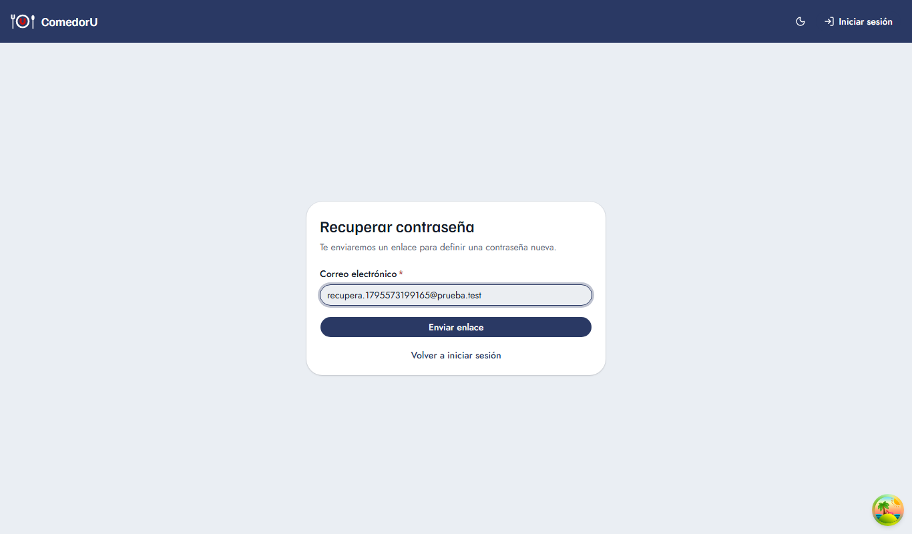
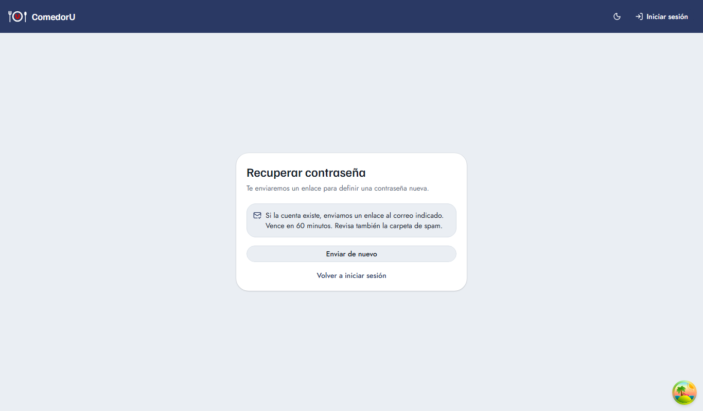
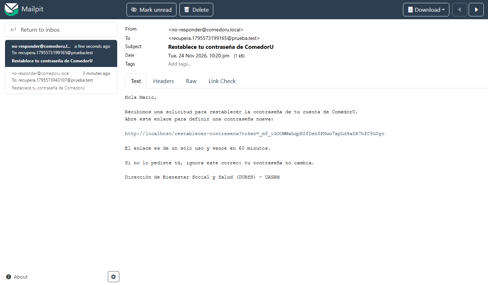
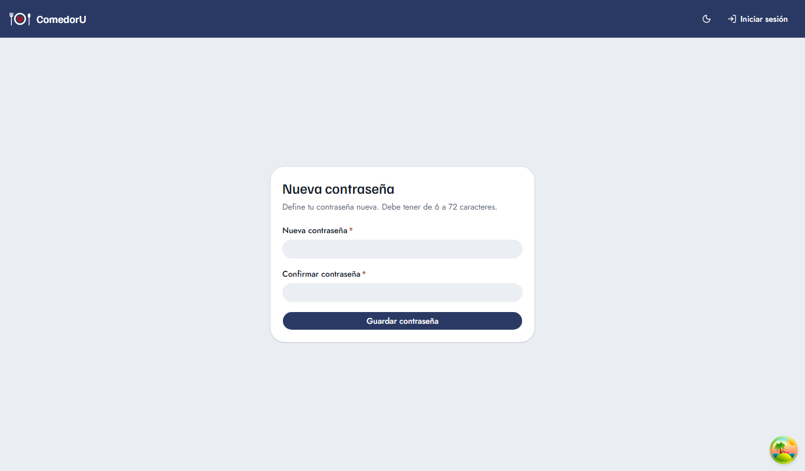
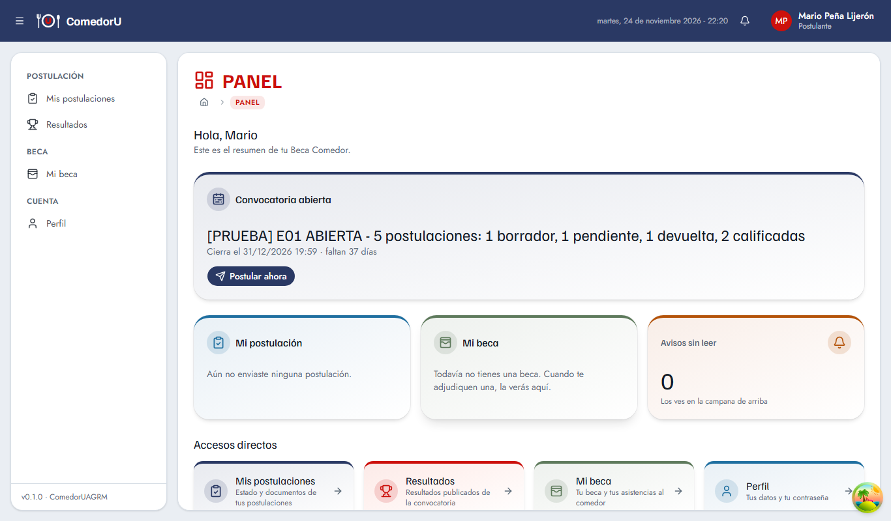
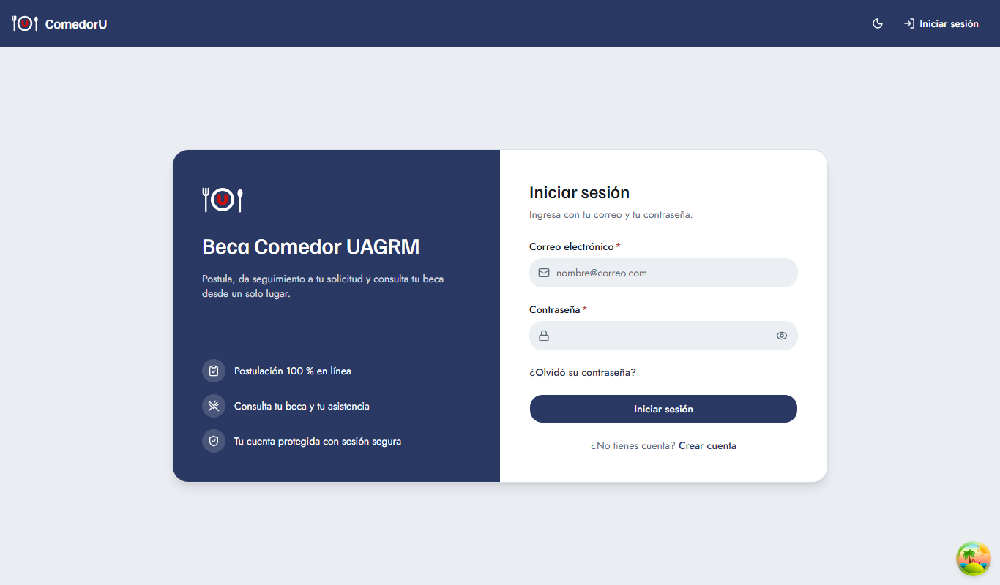
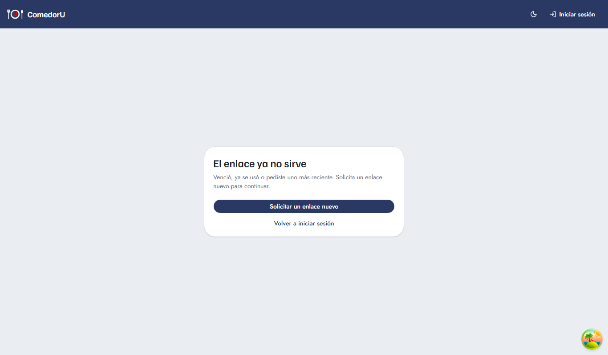
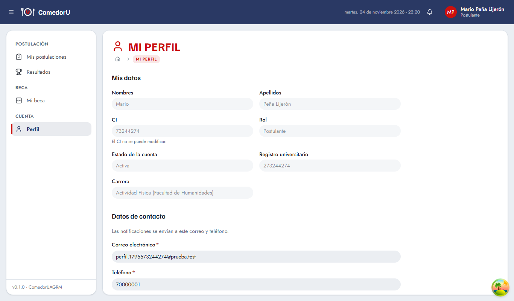
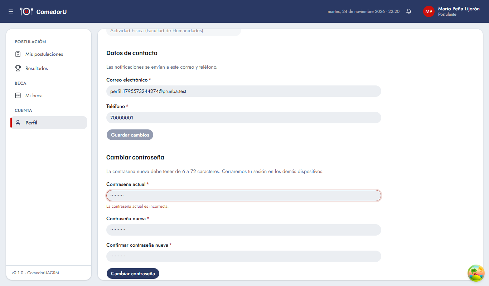
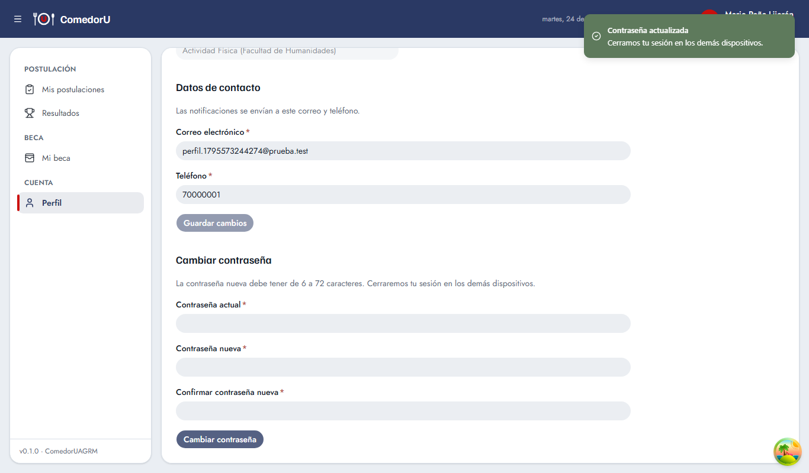

# CU-15. Recuperar contraseña y gestionar perfil

Estructura de la tabla: sección 9.2.1 del documento de taller. Entorno: web en `http://localhost` (proxy nginx) y API en `http://localhost:8080`. Capturas en `capturas/CU15/`.

### Caso A

| Campo | Contenido |
| --- | --- |
| Nombre del caso de prueba | CU-15. Recuperar contraseña y gestionar perfil (recuperación) |
| Descripción | El usuario pide un enlace temporal, lo recibe por correo, define una contraseña nueva y entra con ella; el enlace sirve una sola vez. |
| Precondición | Cuenta de postulante creada para la prueba (registro previo). Mailpit activo en `http://localhost:8025`. |
| Datos de entrada | Correo de la cuenta, contraseña nueva «NuevaClave456» y su confirmación. |
| Condición de ejecución | No aplica |
| Captura de imagen inicial |  |
| Pasos | 1. Abrir `/recuperar-contrasena`, escribir el correo y enviar. 2. Abrir el correo recibido en Mailpit y copiar el enlace. 3. Abrir el enlace, escribir y confirmar la contraseña nueva y pulsar «Guardar contraseña». 4. Iniciar sesión con la contraseña nueva. |
| Resultado esperado | El sistema responde con un aviso neutro, envía el correo con el enlace, guarda la contraseña nueva y permite entrar con ella. |
| Resultado obtenido | Aviso: «Si la cuenta existe, enviamos un enlace al correo indicado. Vence en 60 minutos.». Mailpit recibió «Restablece tu contraseña de ComedorU». Tras guardar, la aplicación fue a `/login` y el inicio de sesión con la contraseña nueva llevó a `/panel`. |
| Captura de imagen final |      |
| Resultado de prueba | **Correcto** |

### Caso B

| Campo | Contenido |
| --- | --- |
| Nombre del caso de prueba | CU-15. Recuperar contraseña y gestionar perfil (enlace de un solo uso) |
| Descripción | Un enlace ya usado no debe permitir cambiar la contraseña otra vez. |
| Precondición | El enlace del caso A ya fue usado. |
| Datos de entrada | El mismo enlace y la contraseña «OtraClave789». |
| Condición de ejecución | No aplica |
| Captura de imagen inicial | No aplica: la prueba comprueba un estado y no tiene pantalla previa distinta de la final. |
| Pasos | 1. Abrir de nuevo el enlace del correo. 2. Escribir una contraseña y su confirmación y pulsar «Guardar contraseña». |
| Resultado esperado | El sistema indica que el enlace ya no sirve. |
| Resultado obtenido | Se mostró «El enlace ya no sirve. Venció, ya se usó o pediste uno más reciente.» con la opción «Solicitar un enlace nuevo». |
| Captura de imagen final |  |
| Resultado de prueba | **Correcto** |

### Caso C

| Campo | Contenido |
| --- | --- |
| Nombre del caso de prueba | CU-15. Recuperar contraseña y gestionar perfil (cambio desde el perfil) |
| Descripción | Desde `/perfil` el usuario cambia su contraseña confirmando la actual. |
| Precondición | Postulante con sesión abierta (contraseña actual «Clave123»). |
| Datos de entrada | Contraseña actual incorrecta «EstaNoEs1», luego la correcta «Clave123»; nueva «Nueva12345» y su confirmación. |
| Condición de ejecución | No aplica |
| Captura de imagen inicial |  |
| Pasos | 1. Abrir `/perfil`. 2. Escribir una contraseña actual incorrecta, la nueva y su confirmación y pulsar «Cambiar contraseña». 3. Corregir la contraseña actual y pulsar de nuevo «Cambiar contraseña». |
| Resultado esperado | Con la actual incorrecta se rechaza el cambio; con la correcta se actualiza y se avisa que las demás sesiones se cierran. |
| Resultado obtenido | Con la actual incorrecta apareció «La contraseña actual es incorrecta.» bajo el campo. Con la correcta apareció «Contraseña actualizada. Cerramos tu sesión en los demás dispositivos.». |
| Captura de imagen final |   |
| Resultado de prueba | **Correcto** |
