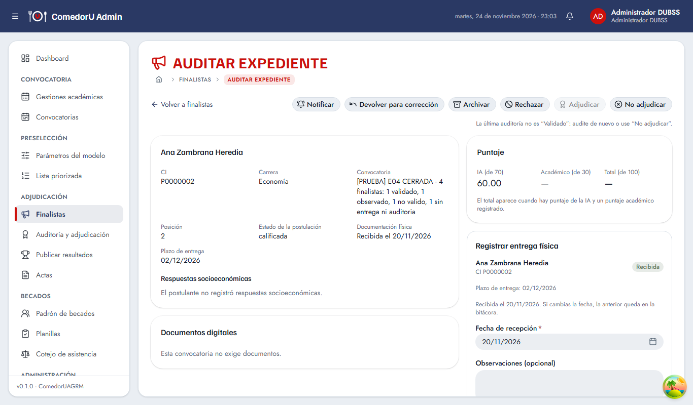
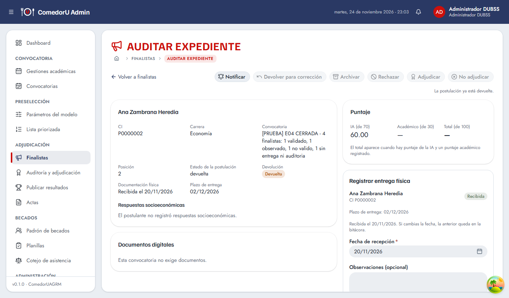
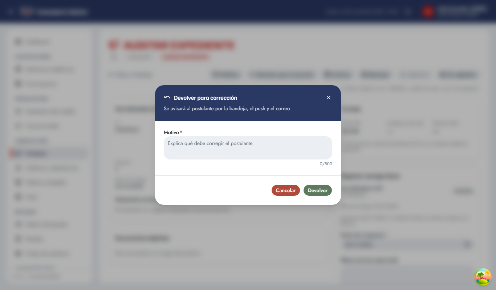
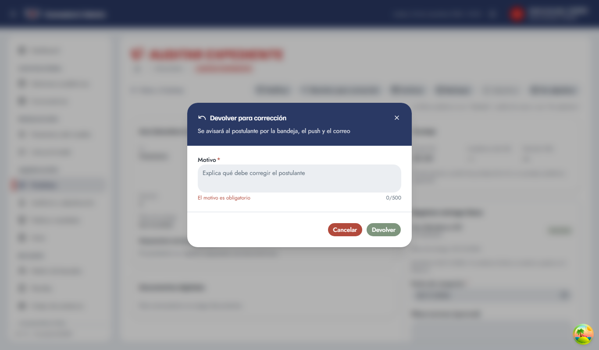

# CU-19. Devolver postulación para corrección

Estructura de la tabla: sección 9.2.1 del documento de taller. Entorno: web en `http://localhost` (proxy nginx) y API en `http://localhost:8080`. Capturas en `capturas/CU19/`.

### Caso A

| Campo | Contenido |
| --- | --- |
| Nombre del caso de prueba | CU-19. Devolver postulación para corrección (devolución) |
| Descripción | El administrador devuelve al postulante una postulación calificada con auditoría, indicando el motivo. |
| Precondición | Sesión del administrador. Finalista 2 (Ana Zambrana Heredia) de «[PRUEBA] E04», calificada y con auditoría «Observado». |
| Datos de entrada | Motivo «Falta la fotocopia legible del certificado de ingresos; vuelva a presentarla.» |
| Condición de ejecución | El motivo es obligatorio (máximo 500 caracteres). |
| Captura de imagen inicial |  |
| Pasos | 1. Abrir el expediente del finalista 2 de E04. 2. Pulsar «Devolver para corrección». 3. Escribir el motivo. 4. Pulsar «Devolver». |
| Resultado esperado | El estado de la postulación pasa a «devuelta». |
| Resultado obtenido | La ventana indicó «Se avisará al postulante por la bandeja, el push y el correo». Tras confirmar, el expediente mostró «Estado de la postulación devuelta». |
| Captura de imagen final |   |
| Resultado de prueba | **Correcto** |

### Caso B

| Campo | Contenido |
| --- | --- |
| Nombre del caso de prueba | CU-19. Devolver postulación para corrección (motivo vacío) |
| Descripción | El sistema exige el motivo de la devolución. |
| Precondición | Finalista 3 de E04 con auditoría. |
| Datos de entrada | Motivo vacío. |
| Condición de ejecución | No aplica |
| Captura de imagen inicial |  |
| Pasos | 1. Abrir el expediente y pulsar «Devolver para corrección». 2. Dejar vacío el motivo y pulsar «Devolver». |
| Resultado esperado | No se devuelve y se muestra que el motivo es obligatorio. |
| Resultado obtenido | La ventana siguió abierta con el mensaje «El motivo es obligatorio». |
| Captura de imagen final |  |
| Resultado de prueba | **Correcto** |
