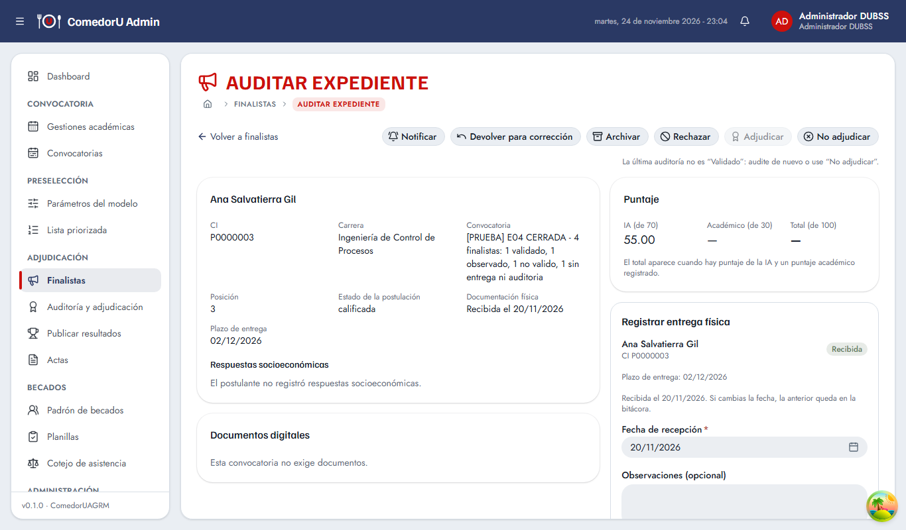
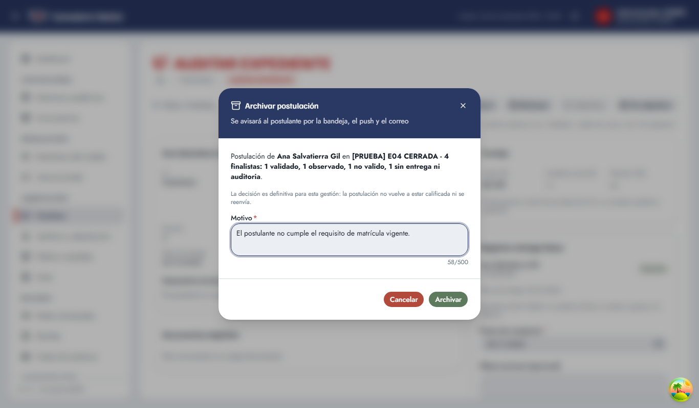
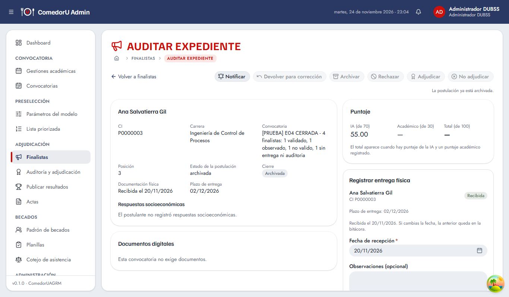
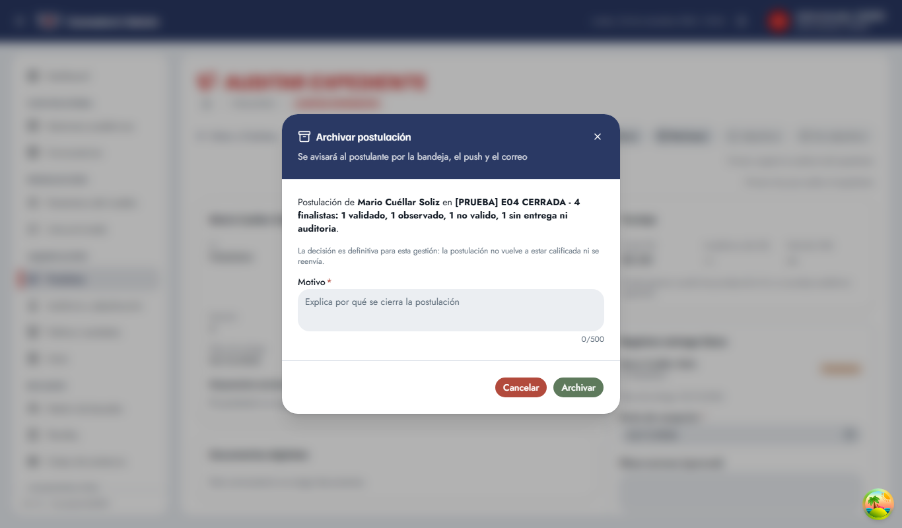
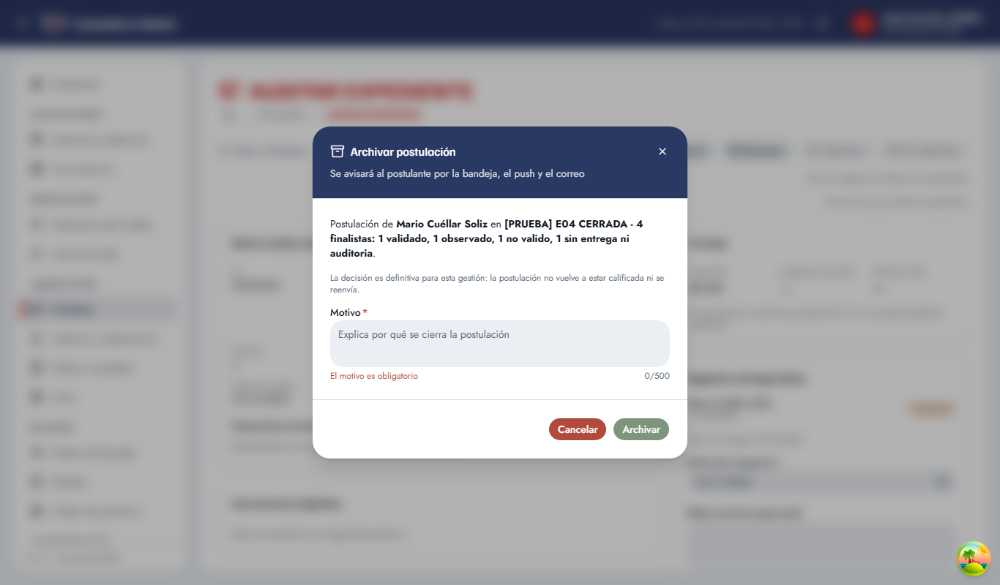

# CU-20. Archivar o rechazar postulación

Estructura de la tabla: sección 9.2.1 del documento de taller. Entorno: web en `http://localhost` (proxy nginx) y API en `http://localhost:8080`. Capturas en `capturas/CU20/`.

### Caso A

| Campo | Contenido |
| --- | --- |
| Nombre del caso de prueba | CU-20. Archivar o rechazar postulación (archivar) |
| Descripción | El administrador archiva una postulación calificada indicando el motivo; la decisión es definitiva para la gestión. |
| Precondición | Finalista 3 (Ana Salvatierra Gil) de «[PRUEBA] E04», calificada, con resultados sin publicar. |
| Datos de entrada | Motivo «El postulante no cumple el requisito de matrícula vigente.» |
| Condición de ejecución | Motivo obligatorio (máximo 500); la convocatoria no debe tener resultados publicados. |
| Captura de imagen inicial |  |
| Pasos | 1. Abrir el expediente del finalista 3 de E04. 2. Pulsar «Archivar». 3. Escribir el motivo. 4. Pulsar «Archivar» en la ventana. |
| Resultado esperado | La postulación queda «archivada». |
| Resultado obtenido | La ventana advirtió que la decisión es definitiva. Tras confirmar, el expediente mostró «Estado de la postulación archivada». |
| Captura de imagen final |   |
| Resultado de prueba | **Correcto** |

### Caso B

| Campo | Contenido |
| --- | --- |
| Nombre del caso de prueba | CU-20. Archivar o rechazar postulación (motivo vacío) |
| Descripción | El sistema exige el motivo. |
| Precondición | Finalista 4 (Mario Cuéllar Soliz) de E04. |
| Datos de entrada | Motivo vacío. |
| Condición de ejecución | No aplica |
| Captura de imagen inicial |  |
| Pasos | 1. Abrir el expediente y pulsar «Archivar». 2. Pulsar «Archivar» sin escribir el motivo. |
| Resultado esperado | No se archiva y se muestra que el motivo es obligatorio. |
| Resultado obtenido | La ventana siguió abierta con «El motivo es obligatorio». |
| Captura de imagen final |  |
| Resultado de prueba | **Correcto** |
