# CU-21. Notificar finalistas y publicar comunicados

Estructura de la tabla: sección 9.2.1 del documento de taller. Entorno: web en `http://localhost` (proxy nginx) y API en `http://localhost:8080`. Capturas en `capturas/CU21/`.

### Caso A

| Campo | Contenido |
| --- | --- |
| Nombre del caso de prueba | CU-21. Notificar finalistas y publicar comunicados (notificación) |
| Descripción | El administrador avisa a un finalista el plazo, lugar y documentos de entrega; el aviso llega por bandeja, push y correo. |
| Precondición | Sesión del administrador. Convocatoria sembrada «[PRUEBA] E03» con 4 finalistas sin notificar. |
| Datos de entrada | Finalista 1 (Elena Suárez Molina), plazo 15/12/2026, lugar y horario «Oficina de la DUBSS, planta baja, de 08:00 a 12:00», documentos «Fotocopia de carnet, certificado de ingresos y boleta de luz». |
| Condición de ejecución | El plazo debe ser posterior a la fecha de hoy. |
| Captura de imagen inicial |  |
| Pasos | 1. Abrir «Finalistas» y elegir la convocatoria E03. 2. Marcar a Elena y pulsar «Notificar seleccionados». 3. Elegir el plazo en el calendario y completar lugar y documentos; pulsar «Enviar aviso». 4. Pulsar «Confirmar envío» en la ventana de confirmación. |
| Resultado esperado | El sistema informa el envío, el finalista pasa a «Enviada» y el correo llega a su bandeja. |
| Resultado obtenido | La ventana «Resultado del envío» dijo «Se está enviando el aviso a 1 finalista». En la tabla Elena quedó en «Enviada» y Mailpit recibió «Entrega de documentación física - Beca Comedor» para `postulante.0000001@prueba.local`. |
| Captura de imagen final | 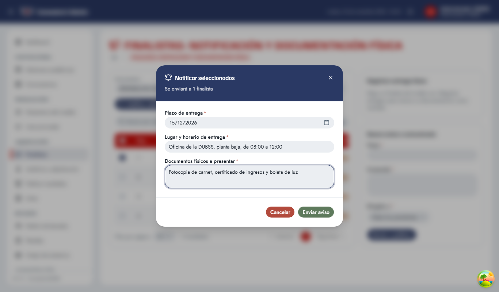 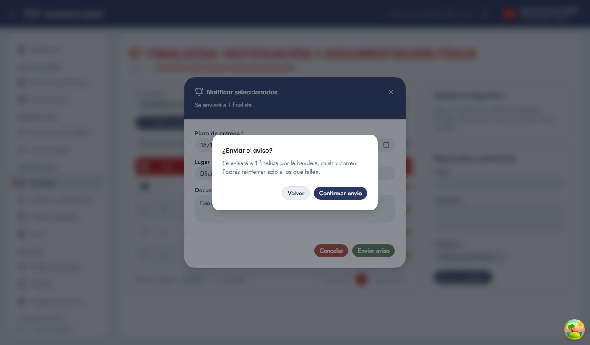 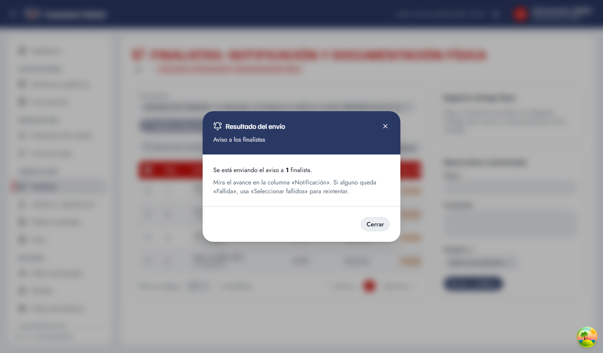 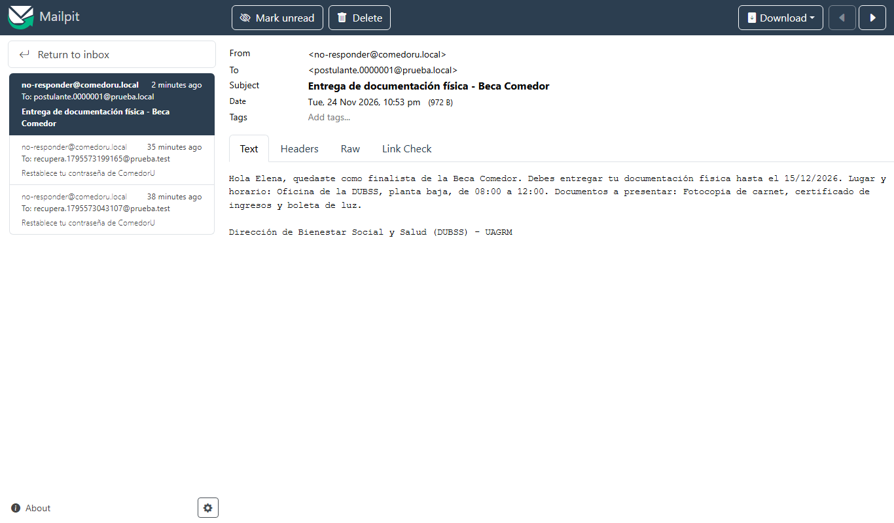 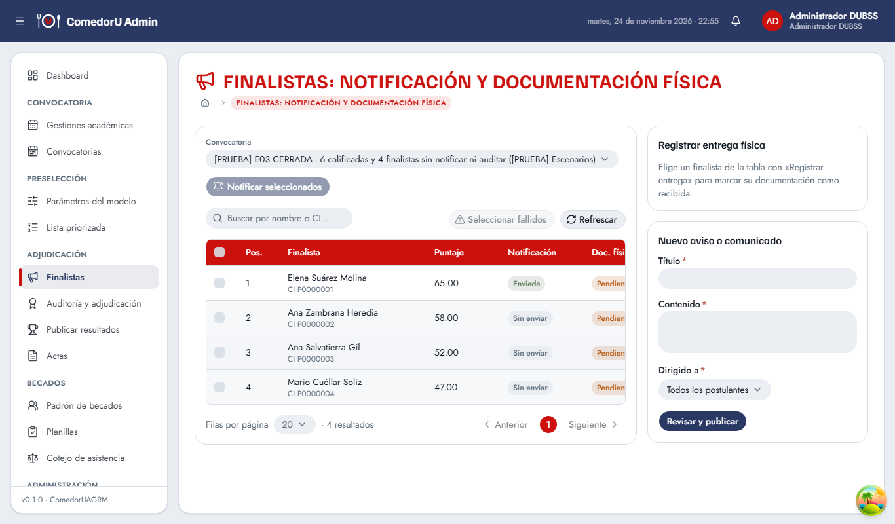 |
| Resultado de prueba | **Correcto** |

### Caso B

| Campo | Contenido |
| --- | --- |
| Nombre del caso de prueba | CU-21. Notificar finalistas y publicar comunicados (plazo inválido) |
| Descripción | El sistema no deja enviar el aviso con un plazo vencido o vacío. |
| Precondición | Finalista 2 (Ana Zambrana Heredia) de E03 sin notificar. |
| Datos de entrada | Intento de elegir el 1/11/2026 (fecha pasada); lugar «Oficina de la DUBSS»; documentos «Carnet». |
| Condición de ejecución | No aplica |
| Captura de imagen inicial | 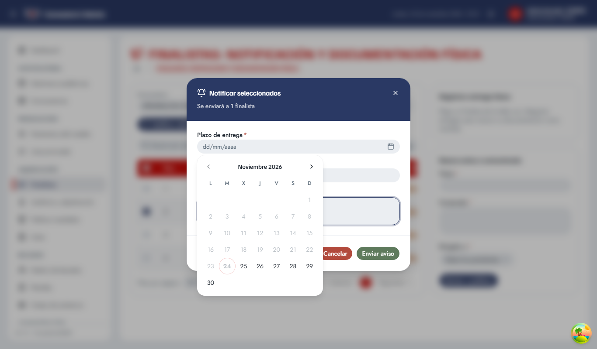 |
| Pasos | 1. Marcar a Ana Zambrana y pulsar «Notificar seleccionados». 2. Abrir el calendario del plazo e intentar elegir el 1 de noviembre. 3. Completar lugar y documentos y pulsar «Enviar aviso». |
| Resultado esperado | No se puede elegir una fecha pasada y el envío se bloquea mostrando que el plazo es obligatorio. |
| Resultado obtenido | El calendario no permitió elegir el día pasado (día deshabilitado) y al enviar apareció «El plazo de entrega es obligatorio»; no se envió el aviso. |
| Captura de imagen final | 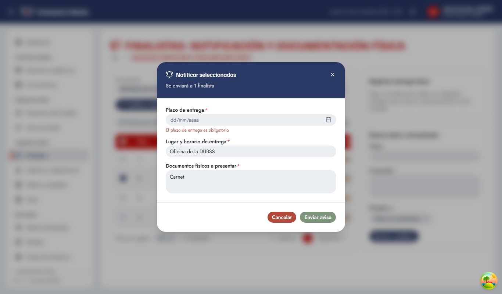 |
| Resultado de prueba | **Correcto** |

### Caso C

| Campo | Contenido |
| --- | --- |
| Nombre del caso de prueba | CU-21. Notificar finalistas y publicar comunicados (comunicado) |
| Descripción | El administrador redacta un comunicado, revisa y lo publica a un grupo de destinatarios. |
| Precondición | Convocatoria E03 seleccionada (4 finalistas). |
| Datos de entrada | Título «Recordatorio de entrega de documentos», contenido «Recuerde presentar su documentación física antes del plazo indicado.», destinatarios «finalistas». |
| Condición de ejecución | No aplica |
| Captura de imagen inicial | 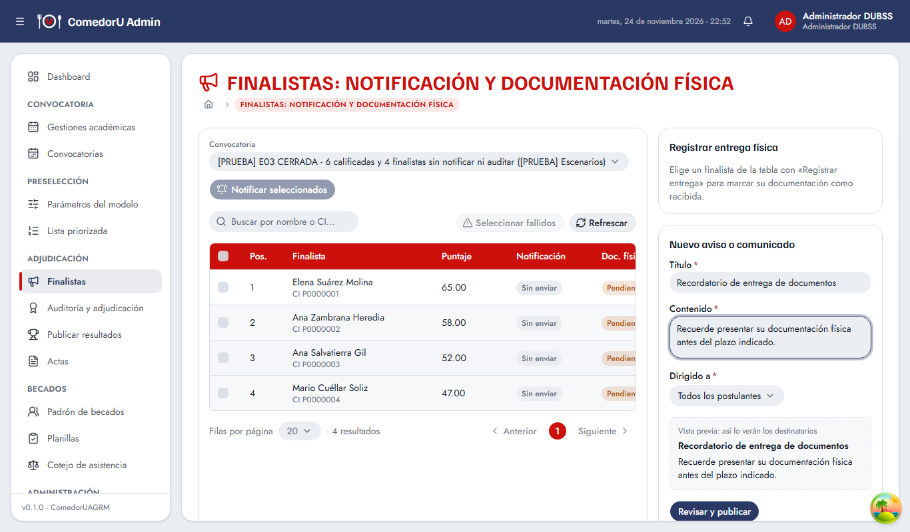 |
| Pasos | 1. En «Nuevo aviso o comunicado» escribir el título y el contenido y elegir «finalistas». 2. Pulsar «Revisar y publicar» y revisar la vista previa. 3. Pulsar «Confirmar publicación». |
| Resultado esperado | El comunicado se publica y se informa a cuántos destinatarios llegó. |
| Resultado obtenido | La ventana preguntó «¿Publicar el comunicado? Se enviará a finalistas y no podrás editarlo ni borrarlo después.» y el resultado fue «Se envió a 4 destinatarios.». |
| Captura de imagen final | 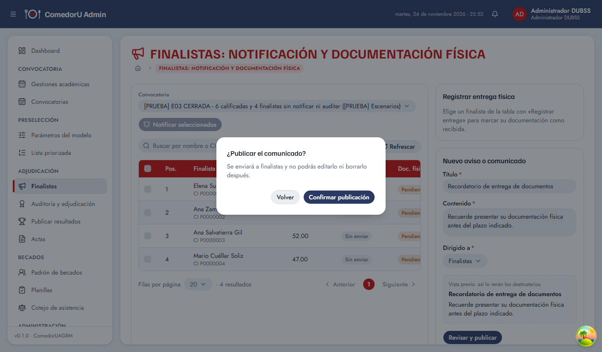 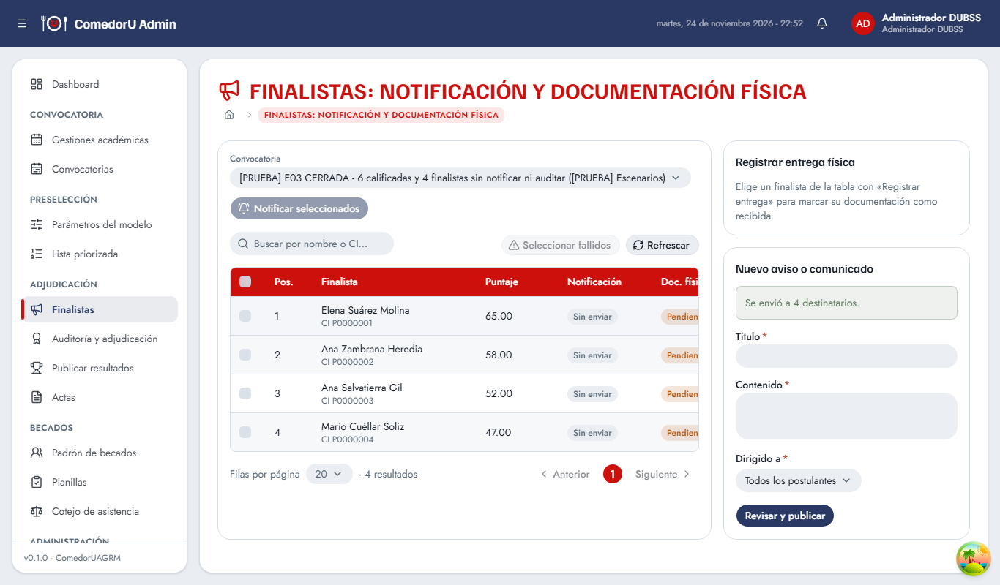 |
| Resultado de prueba | **Correcto** |

### Caso D

| Campo | Contenido |
| --- | --- |
| Nombre del caso de prueba | CU-21. Notificar finalistas y publicar comunicados (sin destinatarios) |
| Descripción | El sistema avisa cuando el grupo elegido no tiene destinatarios. |
| Precondición | Convocatoria seleccionada por defecto «[PRUEBA] Convocatoria sin postulaciones» (sin finalistas). |
| Datos de entrada | Título y contenido de prueba, destinatarios «finalistas». |
| Condición de ejecución | No aplica |
| Captura de imagen inicial | 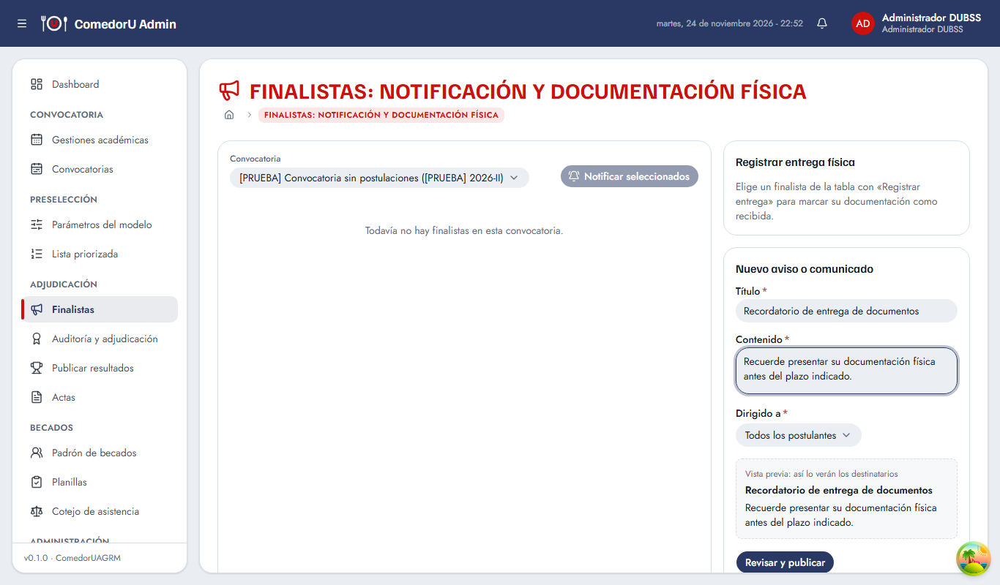 |
| Pasos | 1. Escribir título y contenido y elegir «finalistas». 2. Pulsar «Revisar y publicar» y luego «Confirmar publicación». |
| Resultado esperado | No se publica y se informa que no hay destinatarios. |
| Resultado obtenido | Se mostró «No hay destinatarios para ese comunicado.». |
| Captura de imagen final | 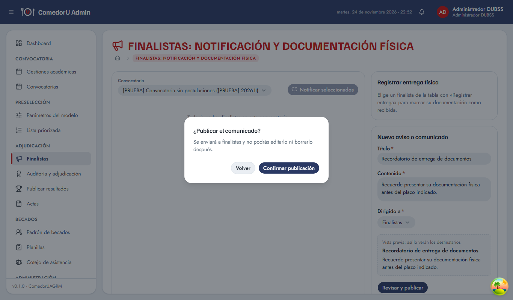 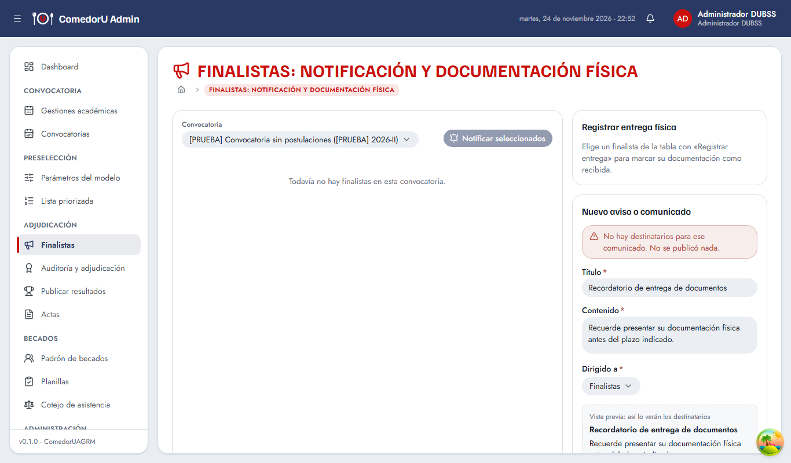 |
| Resultado de prueba | **Correcto** |
