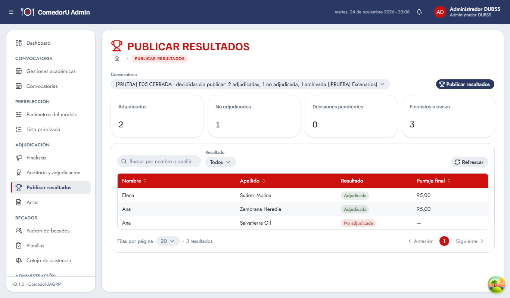
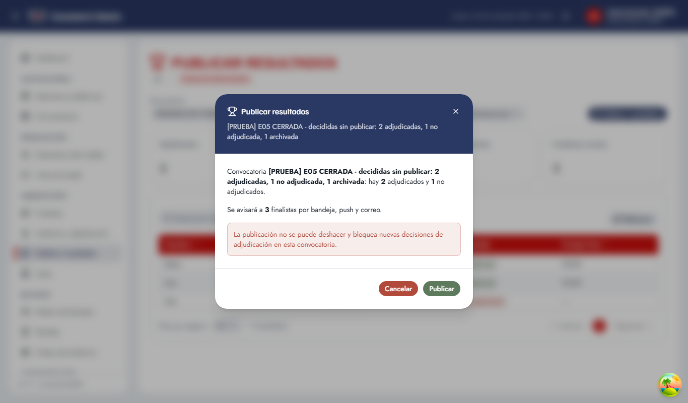
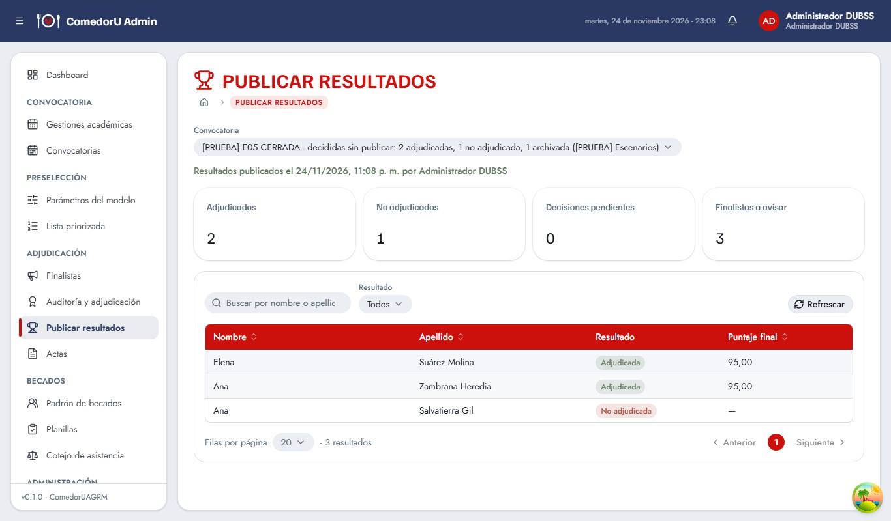
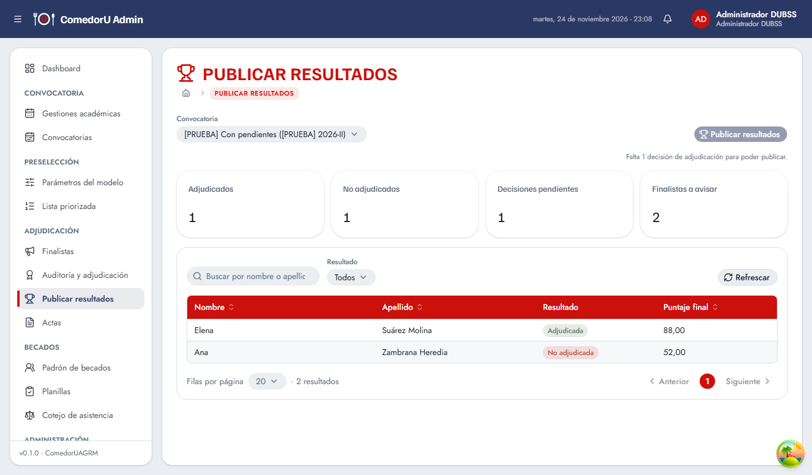
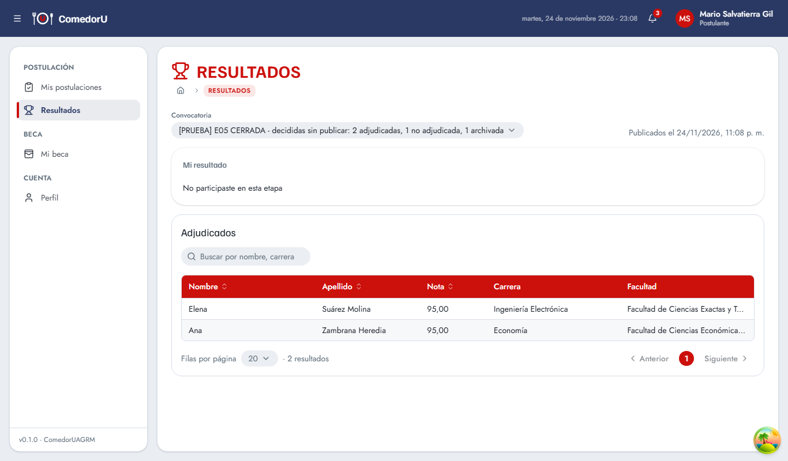
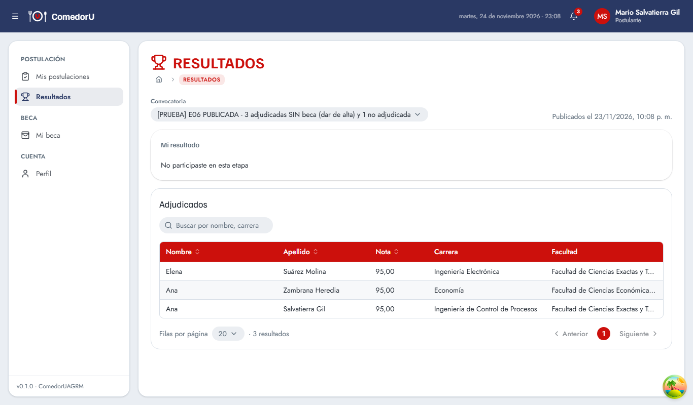

# CU-22. Publicar resultados de adjudicación

Estructura de la tabla: sección 9.2.1 del documento de taller. Entorno: web en `http://localhost` (proxy nginx) y API en `http://localhost:8080`. Capturas en `capturas/CU22/`.

### Caso A

| Campo | Contenido |
| --- | --- |
| Nombre del caso de prueba | CU-22. Publicar resultados de adjudicación (publicación) |
| Descripción | El administrador publica las decisiones de una convocatoria cerrada y se avisa a los finalistas. |
| Precondición | Convocatoria sembrada «[PRUEBA] E05»: cerrada, 2 adjudicados, 1 no adjudicado, sin decisiones pendientes. |
| Datos de entrada | Convocatoria E05. |
| Condición de ejecución | La convocatoria debe estar cerrada y sin decisiones pendientes; la publicación no se puede deshacer. |
| Captura de imagen inicial |  |
| Pasos | 1. Abrir «Publicar resultados» y elegir E05. 2. Pulsar «Publicar resultados». 3. Confirmar con «Publicar» en la ventana. |
| Resultado esperado | Se publican los resultados y se envía un aviso a cada finalista con decisión. |
| Resultado obtenido | La ventana indicó «hay 2 adjudicados y 1 no adjudicados. Se avisará a 3 finalistas…». Tras publicar apareció «publicados el 24/11/2026, 11:08 p. m.» y Mailpit recibió tres correos «Beca Comedor: resultado de tu postulación» (postulante.0000001, 0000002 y 0000003). |
| Captura de imagen final |   |
| Resultado de prueba | **Correcto** |

### Caso B

| Campo | Contenido |
| --- | --- |
| Nombre del caso de prueba | CU-22. Publicar resultados de adjudicación (decisiones pendientes) |
| Descripción | No se publica una convocatoria con finalistas sin decidir. |
| Precondición | Convocatoria «[PRUEBA] Con pendientes» con 1 finalista sin decisión. |
| Datos de entrada | Convocatoria «Con pendientes». |
| Condición de ejecución | No aplica |
| Captura de imagen inicial |  |
| Pasos | 1. Abrir «Publicar resultados» y elegir «Con pendientes». 2. Intentar pulsar «Publicar resultados». |
| Resultado esperado | El botón está deshabilitado y se indica cuántas decisiones faltan. |
| Resultado obtenido | Se mostró «Falta 1 decisión de adjudicación para poder publicar.» y el botón estaba deshabilitado. |
| Captura de imagen final |  |
| Resultado de prueba | **Correcto** |

### Caso C

| Campo | Contenido |
| --- | --- |
| Nombre del caso de prueba | CU-22. Publicar resultados de adjudicación (consulta del postulante) |
| Descripción | El postulante ve la lista pública de adjudicados de las convocatorias publicadas. |
| Precondición | Sesión de `postulante.finalista@prueba.local`; E05 recién publicada. |
| Datos de entrada | Convocatorias E05 y E06. |
| Condición de ejecución | No aplica |
| Captura de imagen inicial |  |
| Pasos | 1. Abrir `/resultados`. 2. Revisar la convocatoria E05 y elegir la E06. |
| Resultado esperado | Se muestran fecha de publicación, «Mi resultado» y la lista de adjudicados con nombre, nota, carrera y facultad (sin motivos de decisión). |
| Resultado obtenido | E05 mostró «Publicados el 24/11/2026», «Mi resultado: No participaste en esta etapa» y 2 adjudicados con nota 95,00, carrera y facultad. E06 mostró 3 adjudicados. |
| Captura de imagen final |  |
| Resultado de prueba | **Correcto** |
